# PLAYDATA 캠퍼스 메타버스

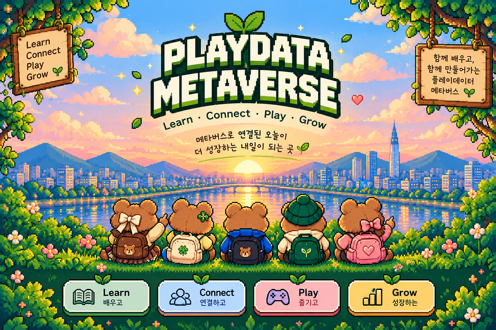

PLAYDATA 캠퍼스 메타버스는 부트캠프 수강생이 가상 캠퍼스에서 동료를 만나고, 학습하고, 쉬는 시간의 콘텐츠와 캠퍼스 소식을 함께 즐기는 서비스입니다.

3차 프로젝트에서 캠퍼스와 커뮤니티, 학습교실, 캠퍼스 광고를 만들었습니다. **4차 프로젝트에서는 그 위에 행사와 광고를 얹었습니다.** 캠퍼스 전체를 **빼빼로 데이 이벤트 캠퍼스**로 바꿔 실제 행사를 열었고, 광고는 **교육 과정에 맞춰 내보내는 광고 서비스**로 키웠습니다. 많은 사람이 한꺼번에 들어오는 행사를 버티도록 입장과 실시간 처리도 다시 다듬었습니다.

**서비스 주소**: [bootcampmetaverse.site](https://bootcampmetaverse.site/)

| 구분 | 진행 기간 | 핵심 |
|---|---|---|
| 3차 | 2026년 10월 1일 ~ 2026년 10월 19일 | 가상 캠퍼스, 커뮤니티, Python·SQL 학습교실, 캠퍼스 광고 |
| **4차** | **2026년 11월 10일 ~ 2026년 11월 12일** | **빼빼로 데이 이벤트, 과정별 맞춤 광고, 운영 대시보드, 대규모 접속 대비, 데이터 파이프라인** |

---

## 4차에서 무엇이 달라졌나

| 영역 | 3차 | 4차에서 확장한 것 |
|---|---|---|
| 캠퍼스 | 18층 캠퍼스와 옥상 | 캠퍼스 전체를 **빼빼로 데이 이벤트 맵**으로, 옥상에 미션 전용 실내 공간 ROOM 01·02 |
| 콘텐츠 | 자유 탐색, 옥상 콘텐츠 | **이야기형 메인 미션**, 미니게임, 업적과 수사수첩, 숨은 이야기(이스터에그), 완료 배지와 실제 보상 |
| 학습 | Python·SQL 학습교실 | **CS 학습교실과 1,200문항 문제은행**, 과목별 학습 업적 |
| 광고 | 위치·기간·예산 설정, 노출·클릭 확인 | **대상 과정 고르기**, 위치별 미리보기와 위치별 이미지, 광고별 성과, 광고 주제·과정별 가중치(준비 중) |
| 운영 | — | **매니저·보상 지급 대시보드**, **이벤트 결과 리포트**, 이벤트 개방 제어와 이용 일시정지 |
| 성능 | — | **첫 접속 23.4초 → 6.6초**, 실시간 이동 반영 P95 2,197ms → 7ms, **120명 동시 연결** |
| 데이터 | — | 캠퍼스와 광고의 이벤트를 **유실·중복 없이 모으는 데이터 파이프라인** |

---

## 1. 빼빼로 데이 이벤트 — 사라진 11번째 빼빼로 `4차`

11월 11일 하루, 캠퍼스 전체가 빼빼로 데이 행사장이 됩니다. 탐정 꾸왕이와 함께 사라진 빼빼로의 행방을 쫓는 이야기형 메인 미션을 중심으로, 미니게임과 숨은 이야기, 업적 수집을 즐깁니다.

### 기획 배경과 목표

| 항목 | 내용 |
|---|---|
| 기획 배경 | 학습·탐색·게임 행동을 함께 보며, 플랫폼 UX와 다음 학습형 이벤트를 개선할 근거를 얻습니다. |
| 경험 설계 | 사건을 접수하고 캠퍼스 곳곳을 이동하며, 학습 문제와 게임을 거쳐 직접 선물을 만들어 전달합니다. |
| 목표 | 참여자 100명. 참여 수, 미션 성공률, 단계별 완료율, 평균 완료 시간, 재도전율, 이스터에그 발견률을 봅니다. |
| 운영 | 2026년 11월 11일 하루, 로그인한 사용자가 운영 시간 안에서 자유롭게 참여합니다. |

### 이야기

참가자 11명을 위한 선물 11개가 준비되어 있었습니다. 꾸왕이는 "여분 1개"라고 적힌 오래된 재고 기록을 보고 하나를 먹어 버렸습니다. 그 뒤 참가자가 한 명 늘어 여분이 사라졌다는 사실을 몰랐던 것이죠. 참여자는 기록의 시간 순서를 추리해 진실을 밝히고, 새 빼빼로를 직접 만들어 선물 수량을 다시 11개로 되돌립니다.

### 메인 미션

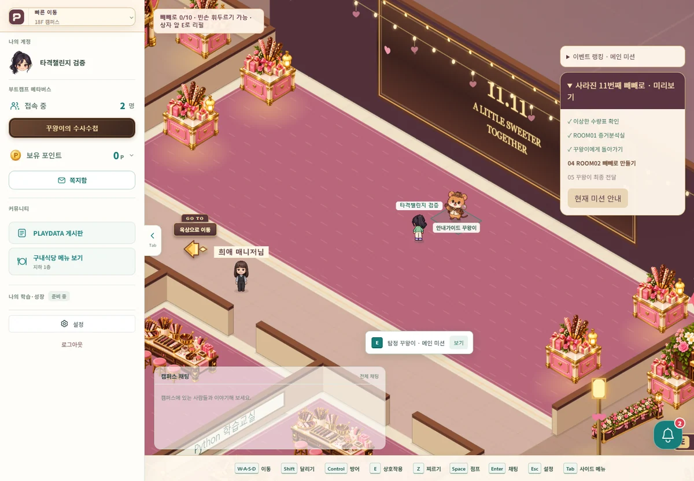

| 단계 | 장소 | 내용 |
|---|---|---|
| 1. 사건 의뢰 | 18층 | 꾸왕이와 대화해 이상한 수량표 조사를 시작합니다. |
| 2. 기록 분석 | 옥상 ROOM 01 | 매니저와 함께 SQL 문제로 수량 기록을 분석합니다. |
| 3. 꾸왕이의 고백 | 18층 | 꾸왕이의 고백을 듣고 10초 빼빼로 타격 챌린지를 완료합니다. |
| 4. 빼빼로 만들기 | 옥상 ROOM 02 쇼콜라 제작실 | 재료 카드 뒤집기 → 초콜릿 코팅 → 토핑 데코 → 선물 포장 |
| 5. 선물 전달 | 18층 | 완성한 선물을 꾸왕이에게 전달합니다. 완료 순번과 순위가 서버에 기록됩니다. |

- 초상화와 선택지가 있는 대화로 이야기가 이어지고, 화면의 화살표가 다음 목적지와 다른 층으로 가는 계단 방향을 안내합니다.
- 미니게임 결과는 서버가 다시 계산해 확인한 뒤에만 다음 단계를 엽니다.

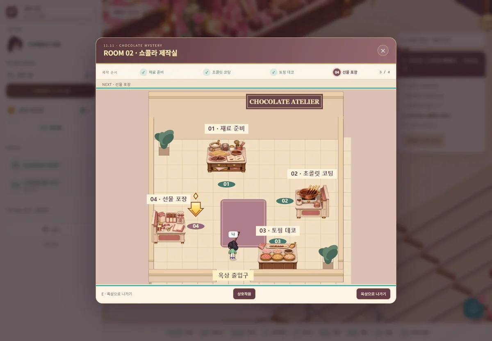

### 미션 완료 배지와 보상

메인 미션을 마치면 **꾸왕이의 명예 조수** 배지를 받고, 공유용 이미지로 달성을 알릴 수 있습니다. 달성자는 11월 12일에 실제 빼빼로를 보상으로 받습니다.

### 빼빼로 찌르기와 리필

3차의 찌르기 인사가 행사에서는 빼빼로 찌르기가 됩니다. 빼빼로를 최대 10개까지 들고 다니며 찌르기에 쓰고, 다 쓰면 리필 상자 앞에서 **E 키**로 다시 채웁니다.

### 직원실 미니게임

18층 직원실 안쪽에서 메인 미션과 별개로 즐기는 세 가지 게임입니다.

| 게임 | 방법 |
|---|---|
| 코드 타이핑 | 화면의 코드를 정확하게 입력합니다. |
| 타이머 맞추기 | 11.11초를 노려 멈춥니다. |
| 페어링 정원 | 카드의 위치를 기억해 짝을 찾습니다. |

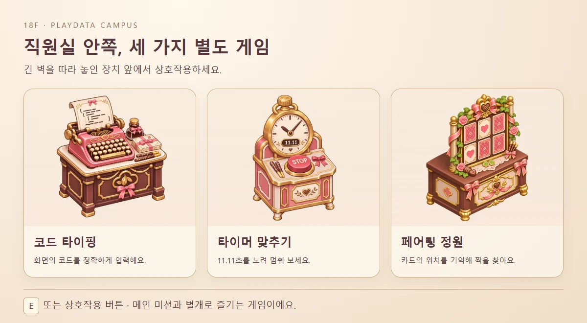

### 꾸왕이의 수사수첩 — 업적과 숨은 이야기

학습, 미니게임, 매니저와의 만남, 숨은 이야기에서 얻은 업적이 수사수첩에 모입니다. 업적마다 달성 순위가 남고, 얻은 업적은 공유할 수 있습니다.

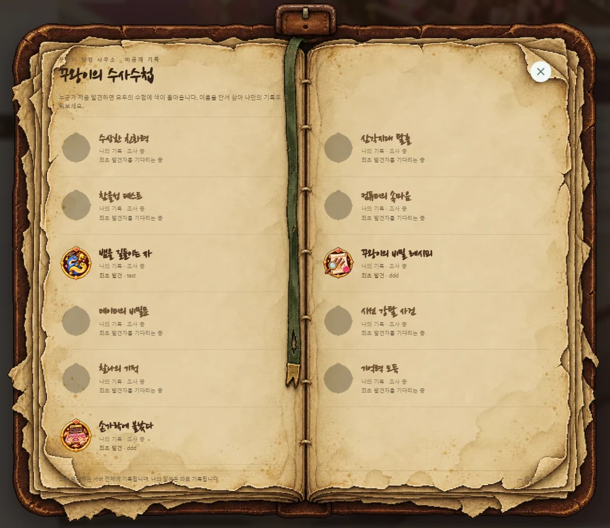

- 캠퍼스 곳곳의 매니저에게 인사하고 찌르면 업적을 얻습니다.
- **꾸왕이의 비밀 레시피**: 옥상 장식 뒤에 숨은 레시피 쪽지를 찾아 꾸왕이에게 돌려주면, 안내 대화가 꾸왕이의 개인적인 고백으로 바뀝니다. "함께 만들기"를 고르면 마지막 레시피를 함께 완성하는 히든 엔딩이 열립니다.
- 빼빼로가 하나만 남았을 때 꾸왕이의 숨은 이야기를 받아들이면, 가장 먼저 해낸 한 사람만 특별 업적을 얻습니다.
- 숨은 이야기는 메인 미션과 따로 진행하며, 선착순과 계정당 달성 횟수 제한이 있습니다.

숨은 이야기는 캠퍼스 광고판으로도 알렸습니다.

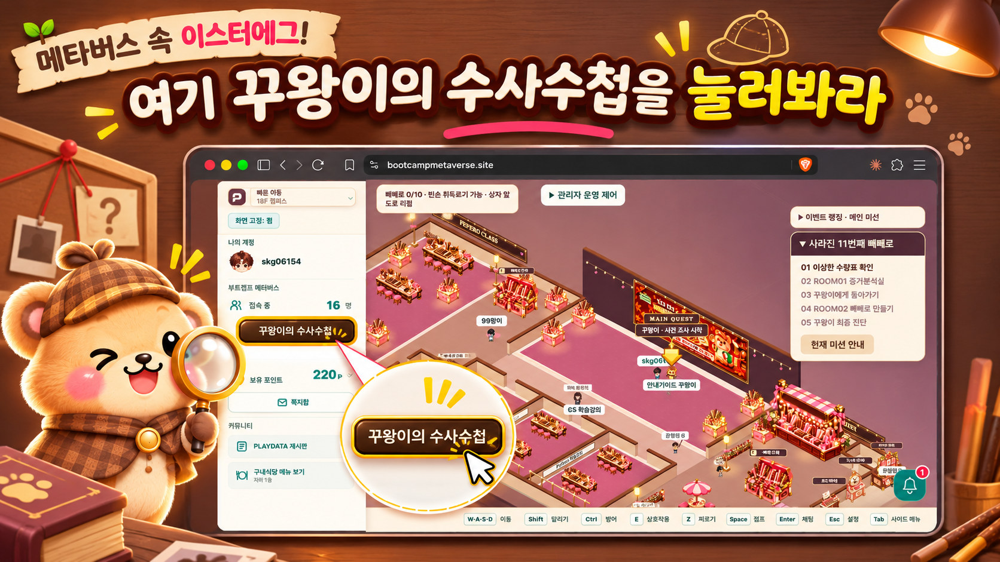

### 행사 운영 제어

- 운영자가 이벤트 개방 상태를 정하고, 강의 시간에는 자동으로 운영 모드가 바뀝니다(관리자 계정은 예외).
- 필요할 때 캠퍼스 이용을 일시정지했다가 재개합니다. 정지 전에 보낸 오래된 입력은 재개 후 반영되지 않습니다.
- 개인별 공지사항 알림함으로 안내를 전하고, 모바일로 로그인하면 PC 접속을 안내합니다.

---

## 2. 과정별 맞춤 광고 `4차`

3차의 캠퍼스 광고는 위치·기간·예산을 정해 광고를 내보내는 데서 멈췄습니다. 4차에서는 **광고의 주제와 교육 과정별 반응을 정리해, 어떤 광고를 누구에게 보여줄지 판단할 수 있게** 만들었습니다.

| 광고 주제 파악 | 과정별 반응 확인 | 운영 기준 제공 |
|---|---|---|
| 광고가 다루는 주제를 분류 | 교육 과정별 관심과 반응을 살펴봄 | 운영자가 활용할 수 있는 기준으로 정리 |

### 광고주가 쓰는 기능

| 기능 | 내용 |
|---|---|
| 대상 과정 고르기 | 광고마다 보여줄 교육 과정을 고릅니다. 고르지 않으면 모든 수강생에게 보입니다. |
| 위치별 미리보기 | 광고판마다 권장 비율과 이미지가 그려지는 방식(늘림·잘림·전체)을 보고, 내 이미지가 실제로 어떻게 보일지 미리 확인합니다. |
| 위치별 이미지 | 같은 광고라도 광고판 위치마다 다른 이미지를 고를 수 있습니다. |
| 광고별 성과 | 기간을 골라 광고마다 노출·클릭·클릭률·전환·전환율을 비교합니다. |

예를 들어 특정 과정 수강생만을 위한 지원 소식은 그 과정에만 보이게 하고, 모두에게 열린 해커톤 소식은 전체에 보이게 할 수 있습니다.

### 캠퍼스 광고판에 오른 광고

광고판을 누르면 광고의 링크로 바로 이동합니다.

| 해커톤 소식 — Firebase 하이브리드 AI 해커톤 | 해커톤 소식 — 서울 AI 여행지도 해커톤 |
|---|---|
| 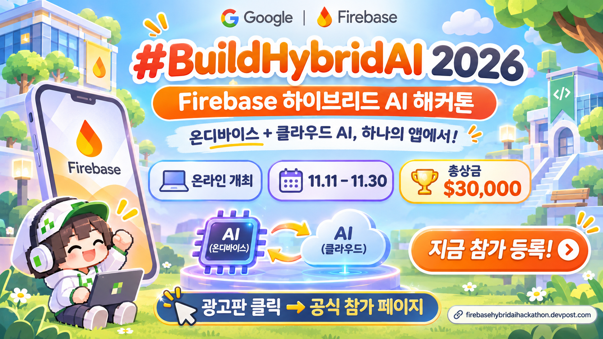 | 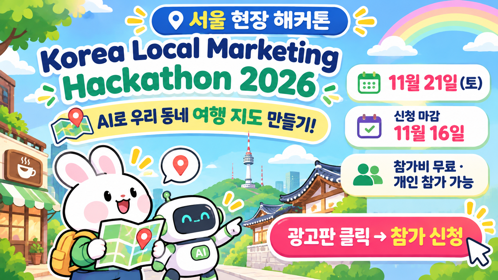 |
| 해커톤 소식 — 키로윈 2026 | 광고 모집 — 광고판에 광고를 띄워보세요 |
| 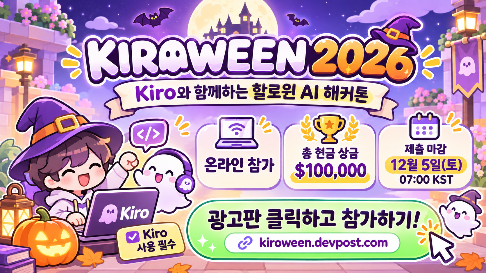 |  |

### 준비 중 — 광고 주제와 과정별 가중치

- 광고마다 주제(카테고리)를 자동으로 분류하고, 과정별 반응을 바탕으로 과정마다 노출 가중치를 정합니다.
- 분류와 가중치를 저장하는 데까지 만들었고, 실제 광고 선택에는 아직 쓰지 않습니다. 광고 성과 향상은 실제 운영에서 확인할 계획입니다.

---

## 3. 운영 대시보드 `4차`

| 대시보드 | 내용 |
|---|---|
| 매니저·보상 지급 | 계정 발급·미션 달성 확인·보상 지급 기록을 한 화면에서 처리합니다. 과정·기수로 대상을 찾고 지급 상태를 확인하며, 명단은 CSV로 내려받아 현장에서 활용합니다. |
| 이벤트 결과 리포트 | 빼빼로·타격·미션·게임 기록으로 참여 인원, 순위, 시간대별 추이와 게임 인기도를 바로 확인합니다. |

---

## 4. 더 빠르고 안정적인 캠퍼스 `4차`

행사에 많은 사람이 한꺼번에 들어와도 버틸 수 있도록 입장과 실시간 처리를 다듬었습니다.

| 개선 | 결과 |
|---|---|
| 입장 로딩 순서 개선 | 첫 접속 23.4초 → 11.6초, 입장 이미지 51.6MB → 25.0MB, 맵 표시 후 5초간 끊김 15회 → 0회 |
| 이미지 WebP 경량화 | 첫 접속 11.7초 → 6.6초(약 44%↓), 입장 이미지 25MB → 11.4MB(약 54%↓) |
| 실시간 처리(20명, 로컬) | 키 입력 → 이동 반영 P95 2,197ms → 7ms, CPU 98% → 32% |
| 동시 접속(100명, 로컬) | 접속 완료 18명 → 100명 |
| 게시판 읽기/쓰기 분리 | 목록 응답 P95 1,402ms → 941ms(약 33%↓) |
| 서버 규모(온프레미스) | 120명 목표 시험에서 120명 전원 연결 |

각 비교는 따로 측정한 값입니다. 로컬 시험은 온프레미스 시험과 환경이 다르고, 120명 시험에서는 강의실 경로의 상호작용 오류가 남아 있었습니다.

서비스는 홈서버 8대와 AWS EC2 8대를 WireGuard로 이은 하이브리드 환경에서 운영합니다. 구성은 [README](README.md)에 있습니다.

---

## 5. 데이터로 이어지는 캠퍼스 `4차`

캠퍼스 이용 기록과 광고 반응을 하나의 데이터 파이프라인으로 모아, 성과 보고와 과정별 맞춤 광고 학습에 씁니다.

- 캠퍼스와 광고 서버의 이벤트가 업무 기록과 함께 남고, 빠지거나 겹치지 않도록 같은 ID로 대조합니다.
- 운영에서는 원본을 모으는 단계가 가동 중이고, 정리·집계 단계는 다음 배포를 준비하고 있습니다.

---

## 대표 이용 흐름

| 이용 목적 | 흐름 |
|---|---|
| **빼빼로 데이 미션 해결하기** `4차` | 18층 꾸왕이에게 의뢰 받기 → ROOM 01 기록 분석 → 빼빼로 타격 챌린지 → ROOM 02에서 빼빼로 만들기 → 선물 전달 → 명예 조수 배지 공유 |
| **업적 모으기** `4차` | 매니저에게 인사·찌르기 → 직원실 미니게임 → 비밀 레시피와 숨은 이야기 찾기 → 수사수첩에서 순위 확인 |
| **과정에 맞춰 광고하기** `4차` | 광고 이미지·연결 주소 등록 → 위치·기간·예산·대상 과정 선택 → 위치별 미리보기로 확인 → 광고별 노출·클릭 성과 비교 |
| **행사 운영하기** `4차` | 이벤트 개방 → 매니저 대시보드에서 미션 달성 확인·보상 지급 → 결과 리포트로 참여 현황 확인 |
| 동료와 교류하기 | 닉네임·캐릭터 설정 → 캠퍼스 탐색 → 채팅·말풍선·찌르기로 인사 → 게시판과 댓글로 대화 이어가기 |
| 학습하고 복습하기 | Python·SQL·CS 학습교실 선택 → 난이도 선택 → 문제 풀이 → 성적·해설 확인 및 오답 복습 → 정답 보상 포인트와 학습 업적 확인 |
| 쉬는 시간 보내기 | 옥상 방문 → 게임 부스·심리 테스트 존·YouTube 스튜디오 중 원하는 콘텐츠 선택 |
| 점심 정하기 | 게시판에서 구내식당 메뉴 확인 → 필요하면 점심 메뉴 룰렛 이용 |

---

## 3차에서 만든 기본 기능

4차의 행사와 광고는 아래 3차 기능 위에서 동작합니다.

| 기능 | 내용 | 4차에서 바뀐 점 |
|---|---|---|
| 가상 캠퍼스와 실시간 소통 | 닉네임·캐릭터로 18층 캠퍼스와 옥상을 탐색하고, 채팅·말풍선·**Z 키** 찌르기로 인사합니다. | 이벤트 맵, 빼빼로 찌르기, 공지 알림함 |
| 캠퍼스 커뮤니티 | 게시판과 댓글로 프로젝트 소식, 질문, 학습 자료, 취업 정보를 나눕니다. | 목록 응답 약 33% 빨라짐 |
| Python·SQL 학습교실 | 초급·중급·고급 객관식과 코드 빈칸 문제, 결과·해설 확인, 오답 복습 | CS 학습교실, 학습 업적 |
| 학습 보상 포인트 | 정답을 맞히면 포인트가 쌓이고, 지도에서 보유 포인트와 내역을 확인합니다. 캠퍼스 포인트와 광고 포인트를 전환하는 기능은 준비 중입니다. | — |
| 옥상 콘텐츠 | 게임 부스, 심리 테스트 존, YouTube 스튜디오, 분수와 쉼터가 있는 광장 | 미션 공간 ROOM 01·02 |
| 식단 확인과 점심 메뉴 추천 | 게시판에서 구내식당 메뉴를 확인하고 점심 메뉴 룰렛으로 고릅니다. | — |
| 캠퍼스 광고 서비스 | 이미지와 연결 주소를 등록하고 위치·기간·예산을 골라 홍보하며, 노출·클릭과 포인트 사용 내역을 확인합니다. | 과정별 맞춤 광고 |

| 찌르기 인사 | 캠퍼스 커뮤니티 | 학습교실 |
|---|---|---|
|  | 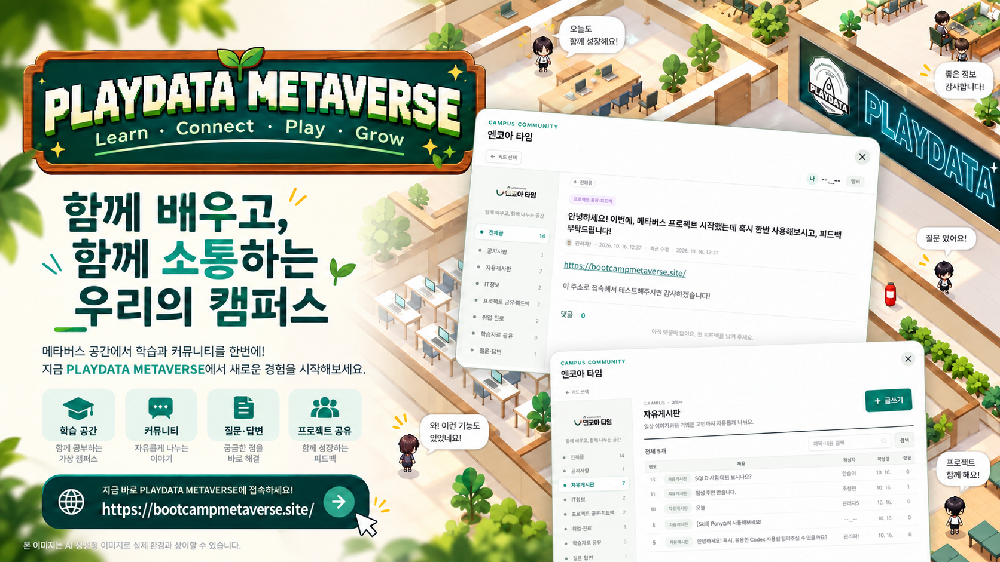 | 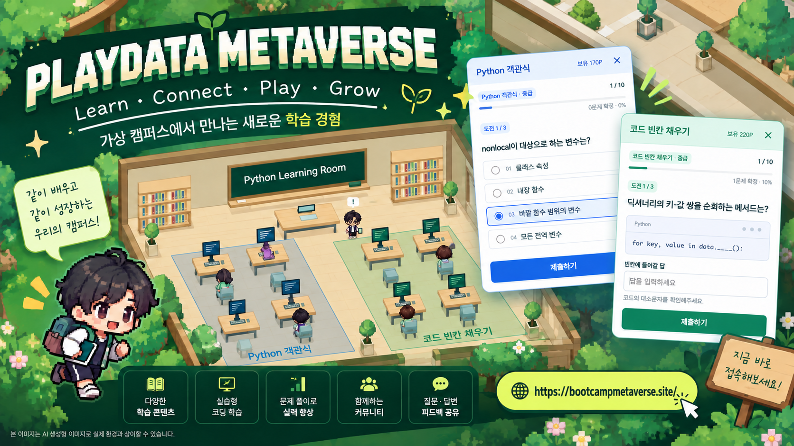 |
| 옥상 콘텐츠 | 식단·점심 메뉴 | 캠퍼스 광고판 |
| 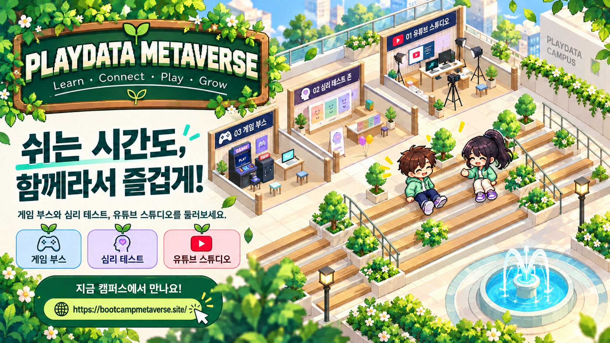 | 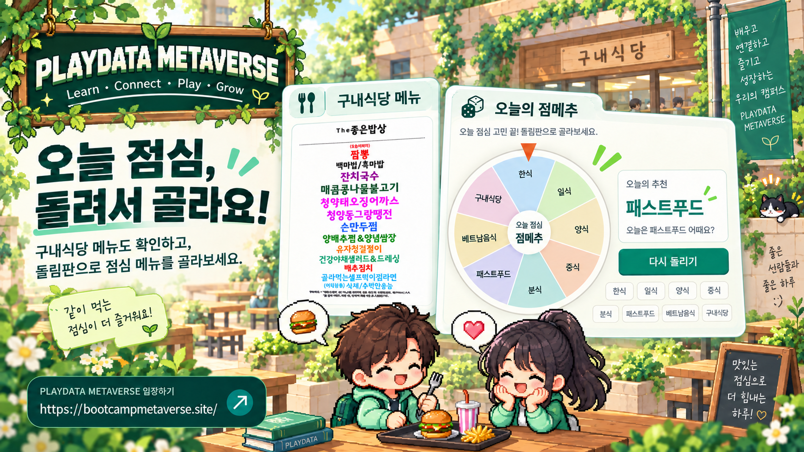 | 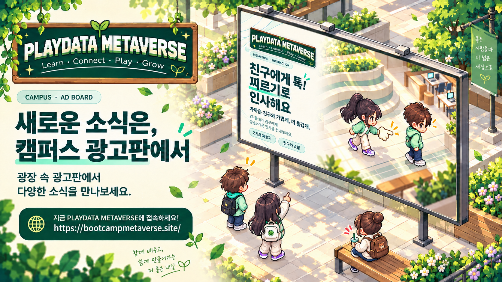 |

---

## 팀 구성

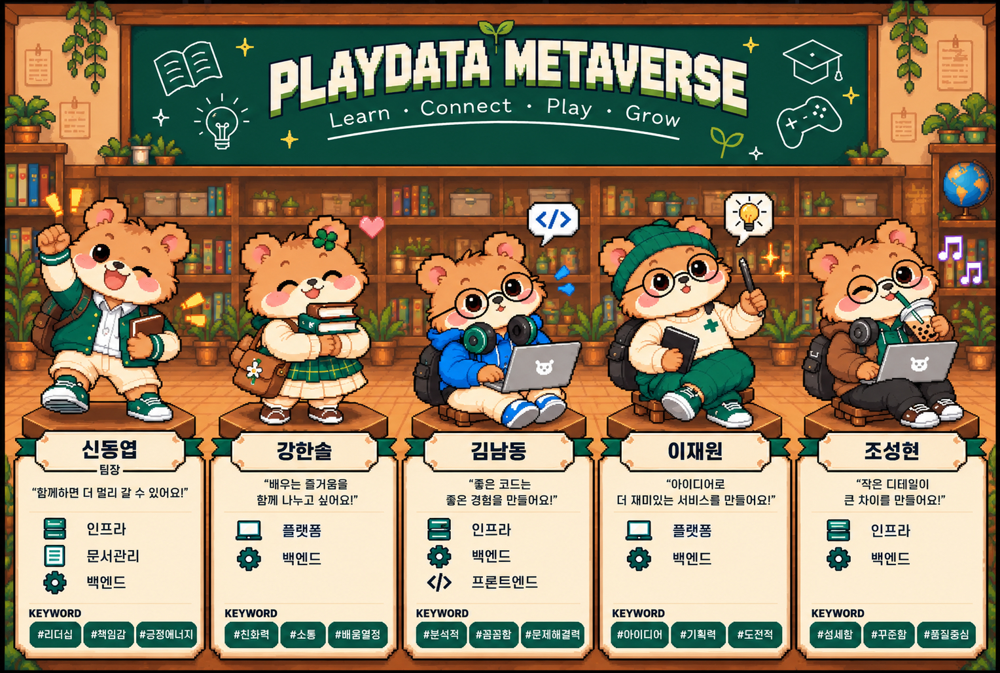

| 이름 | 3차 담당 | 4차 담당 | GitHub |
|---|---|---|---|
| 신동엽 | 데이터 파이프라인 | 데이터 파이프라인 초안, 머신러닝(광고 주제 분류·과정별 가중치) | [sdyeob](https://github.com/sdyeob) |
| 강한솔 | 플랫폼 | 빼빼로 데이 이벤트 기획·설계, 플랫폼 | [hansolsmart](https://github.com/hansolsmart) |
| 김남동 | 광고 서버 | 과정별 맞춤 광고 서버, 데이터 파이프라인 통합 | [rlaskaehd](https://github.com/rlaskaehd) |
| 이재원 | 플랫폼 | 빼빼로 데이 이벤트 구현, 플랫폼 | [vvjeffvv3](https://github.com/vvjeffvv3) |
| 조성현 | 인프라 구축 | 홈서버·클라우드 하이브리드 인프라 | [seonghyeonjo2](https://github.com/seonghyeonjo2) |
