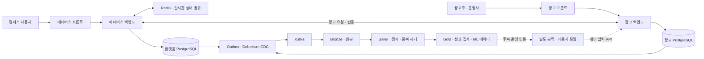

# PLAYDATA METAVERSE · 과정별 맞춤 광고 송출

> 실시간 메타버스 캠퍼스에서 광고를 송출하고, 광고 주제와 교육 과정별 반응 데이터를 연결하는 프로젝트

PLAYDATA 캠퍼스를 옮긴 메타버스에 광고 서비스와 데이터 파이프라인을 결합했습니다. 사용자는 캠퍼스에서 소통하고 학습·게임·미션에 참여하며, 광고주는 캠페인과 소재를 관리합니다. 서비스에서 발생한 이벤트는 분석용 데이터로 정리해 과정별 광고 운영과 머신러닝에 활용할 기반을 만듭니다.

[서비스 기능과 화면 보기](PRODUCT.md) · [개발 환경 실행](#개발-환경-실행) · [관련 문서](#관련-문서)

| 항목 | 내용 |
| --- | --- |
| 프로젝트 | 과정별 맞춤 광고 송출 |
| 팀 | `mlo-01-p4-team2` |
| 진행 기간 | 2026.11.10 ~ 2026.11.12 · 기존 메타버스·광고 서비스 기반 확장 |
| 팀원 | 강한솔, 김남동, 신동엽, 이재원, 조성현 |
| 저장소 | [encore-ai-campus/mlo-01-p4-team2](https://github.com/encore-ai-campus/mlo-01-p4-team2) |

문서의 운영 상태와 측정 수치는 **2026.11.12 프로젝트 기록**을 기준으로 합니다. 당시 내용은 [발표·검증 기록](https://github.com/encore-ai-campus/mlo-01-p4-team2/blob/2389968c45a63ac75cdd81f578b04978bda8b232/README.md)에서 확인할 수 있습니다. 실행 명령은 현재 `main`의 실행 스크립트와 대조했습니다.

**구현 범위:** 메타버스·광고 서비스와 데이터 수집·처리 코드, 모델 결과를 받는 내부 API를 포함합니다. 분류·가중치 모델 코드는 별도이며, 과정별 가중치를 실제 광고 선택에 반영하는 단계와 광고 성과 개선 검증은 후속 과제입니다.

### 팀원별 역할

| 이름 | 4차 프로젝트 담당 | GitHub |
| --- | --- | --- |
| 강한솔 | 빼빼로 데이 이벤트 기획·설계, 플랫폼 | [hansolsmart](https://github.com/hansolsmart) |
| 김남동 | 과정별 맞춤 광고 서버, 데이터 파이프라인 통합 | [rlaskaehd](https://github.com/rlaskaehd) |
| 신동엽 | 데이터 파이프라인 초안, 머신러닝 분류·가중치 | [sdyeob](https://github.com/sdyeob) |
| 이재원 | 빼빼로 데이 이벤트 구현, 플랫폼 | [vvjeffvv3](https://github.com/vvjeffvv3) |
| 조성현 | 홈서버·클라우드 하이브리드 인프라 | [seonghyeonjo2](https://github.com/seonghyeonjo2) |

## 목차

- [프로젝트 배경과 목표](#프로젝트-배경과-목표)
- [주요 기능](#주요-기능)
- [시스템 구성](#시스템-구성)
- [기술 스택](#기술-스택)
- [데이터 파이프라인](#데이터-파이프라인)
- [머신러닝 연동](#머신러닝-연동)
- [성능 개선과 검증](#성능-개선과-검증)
- [저장소 구조](#저장소-구조)
- [개발 환경 실행](#개발-환경-실행)
- [운영과 모니터링](#운영과-모니터링)
- [협업 규칙](#협업-규칙)
- [관련 문서](#관련-문서)

## 프로젝트 배경과 목표

교육 과정마다 관심 주제와 광고에 대한 반응은 다릅니다. 광고를 개별적으로 확인하고 분류하는 반복 업무를 줄이고, 실제 서비스에서 모은 반응을 광고 운영 판단에 활용하고자 했습니다.

- **참여 공간 마련:** 이동·채팅·학습·게임이 가능한 캠퍼스에서 사용자 접점을 만듭니다.
- **광고 운영 통합:** 캠페인·소재·노출·반응·과금을 하나의 서비스 흐름으로 관리합니다.
- **분석 데이터 확보:** 업무 이벤트를 수집하고, 재처리할 때도 같은 이벤트를 추적할 수 있도록 정리합니다.
- **과정별 운영 기반 마련:** 광고 주제와 MLO·AIO·SKN 과정별 반응을 연결해 분류·가중치 산정에 활용합니다.

## 주요 기능

### 메타버스 캠퍼스

| 기능 | 내용 |
| --- | --- |
| 실시간 캠퍼스 | 18층·옥상 이동, 캐릭터·닉네임, 채팅·말풍선·찌르기·점프 |
| 학습교실 | Python·SQL·CS 문제 풀이, 답안·성적 저장, 포인트 적립 |
| 커뮤니티 | 게시판, 공지 알림, 점심 메뉴 조회, 설정에 따른 개인 쪽지 |
| 이벤트 | 빼빼로 이벤트맵, 메인 미션, 매니저 상호작용, 업적·이스터에그 |
| 게임·콘텐츠 | 타이머·코드 타이핑·페어링 정원 등 게임과 옥상 콘텐츠 |
| 광고판 | 광고 서버와 연동해 캠퍼스 내 광고 표시 |
| 운영 화면 | 계정 발급, 미션 달성 확인, 보상 지급 기록, 결과 리포트·CSV 활용 |

기능의 개방 여부는 이벤트 운영 설정과 환경 변수에 따라 달라집니다. 답안·포인트·게임 결과는 재시도 시 중복 반영되지 않도록 처리합니다.

### 광고 서비스

| 기능 | 내용 |
| --- | --- |
| 광고주 콘솔 | 캠페인·광고·소재 관리 및 성과 확인 |
| 광고 송출 | 매체 노출·반응 API, 과정 코드 타게팅 |
| 위치별 소재 설정 | 광고판별 권장 비율·표시 방식 미리보기, 같은 광고의 위치별 이미지 선택 |
| 광고별 성과 | 기간별 노출·클릭·클릭률·전환·전환율 비교 |
| 과금·원장 | 광고 반응 처리와 포인트 과금, 잔액·원장 정합성 확인 |
| 운영 관리 | 권한·심사·감사 로그와 처리 상태 확인 |
| 모델 결과 입력 | 광고 카테고리와 과정별 가중치를 내부 API로 수신·저장 |

광고 프론트는 화면을 렌더링하고 요청을 중계합니다. 로그인·권한·입력 검증·업무 처리는 광고 백엔드가 담당하며, 메타버스 백엔드는 매체 API를 통해 광고 서버에 연결합니다.

광고주는 대상 과정을 직접 선택할 수 있으며, 선택하지 않으면 전체 수강생이 대상이 됩니다. 이 과정 타게팅과 별도 모델이 산정하는 노출 가중치는 서로 다른 기능입니다. 캠퍼스 학습 포인트와 광고 포인트의 전환 기능은 준비 중입니다.

## 시스템 구성



위 그림은 서비스와 통합 데이터 흐름을 요약합니다. 계층별 배포 상태와 모델 연동 범위는 아래에 구분했습니다.

인프라는 **AWS EC2 8대와 홈서버 8대를 WireGuard로 연결한 하이브리드 구성**입니다. 클라우드의 외부 진입·프론트·중계와 내부 서비스·DB·Kafka·모니터링을 연결하고, Kubernetes에서 데이터 처리 작업을 운영합니다. PostgreSQL은 Patroni·etcd·HAProxy 기반 3노드 구성으로 주 서버 전환과 연결 라우팅을 처리합니다.

## 기술 스택

| 영역 | 기술 | 용도 |
| --- | --- | --- |
| 백엔드 | Python, Django | 플랫폼·광고 업무 처리, API·운영 도구 |
| 실시간 통신 | Django Channels, Daphne, WebSocket, Redis | 이동·채팅·상태 공유 |
| 프론트엔드 | Django Templates, JavaScript, HTML/CSS, Canvas | 캠퍼스와 광고주·운영자 화면 |
| 업무 데이터 | PostgreSQL | 계정·학습·포인트·광고 및 이벤트 저장 |
| 이벤트 수집 | Debezium, Kafka, Kafka Connect | Outbox 변경 수집과 전달 |
| 데이터 처리 | Apache Spark, Delta Lake, Amazon S3 | Bronze·Silver·Gold 적재·정제·집계 |
| 인프라 | AWS EC2, Kubernetes, Nginx, WireGuard, WSL | 하이브리드 서비스 운영 |
| 별도 ML 모듈 | Laya, MLPRegressor | 광고 주제 분류·과정별 가중치 산정 |

MongoDB·RustFS와 과거 MySQL 구성은 개발 환경 및 이전 문서에도 등장합니다. 실행 시에는 각 모듈의 설정 예제와 해당 운영 절차를 확인합니다.

## 데이터 파이프라인

### 원본부터 분석용 테이블까지

| 단계 | 역할 |
| --- | --- |
| Outbox | 업무 변경과 같은 트랜잭션으로 이벤트 저장 |
| Debezium → Kafka | PostgreSQL 변경을 수집하고 이벤트 ID를 유지해 전달 |
| Bronze | 원본 메시지·키·헤더·위치 정보를 Delta에 저장. 운영 수집은 1분 주기 |
| Silver | 소스별 파싱·계약 검사, `event_id` 기준 중복 제거, 오류·격리 테이블 관리 |
| Gold | 정합성이 확인된 Silver 버전으로 성과 보고·ML 테이블 집계 |

### 재처리와 정합성

- **같은 이벤트는 같은 ID:** 재발행 시에도 원래 ID를 유지하고 Silver에서 중복을 제거합니다.
- **구간 대조:** Outbox와 Bronze를 시간 창별 ID 수·해시로 비교하고, 누락 구간을 재발행합니다.
- **처리 결과 확인:** 처리 완료된 Bronze 버전을 기준으로 Silver의 정상·오류·격리 결과를 대조합니다.
- **불일치 표시:** ID 누락·충돌과 중복 사본 증가를 구분해 경보를 내고, 문제가 있는 구간은 Gold 확정에 반영합니다.
- **장애 복구:** 복제 슬롯·Connect offset·Spark checkpoint·Delta 트랜잭션으로 처리 위치를 이어갑니다.

**배포 상태:** 2026.11.12 기록 기준, Bronze는 운영 Kubernetes에서 가동 중이며 Silver·Gold는 코드·시험·리뷰를 마치고 2차 배포를 준비하는 단계입니다. 플랫폼 실행 가이드에는 이전 단계의 CDC 안내도 남아 있으므로 통합 구성은 [파이프라인 문서](pipeline/README.md)와 [운영 절차](pipeline/runbooks/README.md)를 함께 확인합니다.

## 머신러닝 연동

광고 주제를 분류하고 과정별 반응으로 가중치를 산정하는 모델은 별도로 관리합니다. 이 저장소에는 **모델이 사용할 데이터와 결과를 받는 API·저장 구조**가 포함되어 있습니다.

| 항목 | 내용 | 확인 범위 |
| --- | --- | --- |
| 광고 주제 분류 | Laya 기반 별도 분류 모듈 | 발표 기록상 로컬 추론·기본 시험 71개 통과 |
| 과정별 가중치 | MLPRegressor 기반 별도 모듈 | 발표 기록상 실제 MLP·로컬 Delta 사용, 시험 63개 통과 |
| 결과 저장 | 카테고리 8비트 비트마스크, MLO·AIO·SKN 가중치 각 0~100 | 내부 입력 API·저장 구현 |
| ML용 집계 | `creative_course_daily` v2 | KST 날짜 × 광고별 카테고리·과정별 클릭 수·클릭률·전환율 |

가중치를 실제 광고 선택에 사용하는 기능은 아직 적용하지 않았습니다. 별도 모델의 실제 광고 서버·S3 등 외부 환경 연동과 예약 작업 배포, 분류 정확도 및 광고 성과 개선도 추가 검증이 필요합니다. 위 시험 수는 별도 모듈의 기존 기록이며 이 저장소에서 재실행한 결과를 뜻하지 않습니다.

## 성능 개선과 검증

다음 수치는 [발표·검증 기록](https://github.com/encore-ai-campus/mlo-01-p4-team2/blob/2389968c45a63ac75cdd81f578b04978bda8b232/README.md)에 남긴 측정 결과입니다. 서로 다른 환경의 결과를 합쳐 하나의 처리 성능으로 해석하지 않습니다.

### 메타버스 최적화

| 개선 항목 | 측정 조건·지표 | 개선 전 → 후 |
| --- | --- | --- |
| 실시간 처리 | 동일 로컬 조건·20명, CPU 사용률 | 98% → 32% |
| 이동 응답 | 동일 로컬 조건·20명, 키 입력 → 이동 P95 | 2,197ms → 7ms |
| 위치 갱신 | 동일 로컬 조건·20명, 다른 사용자 위치 간격 P95 | 2,511ms → 116ms |
| 연결 처리 | 로컬 100명 접속 시도, 접속 완료 | 18명 → 100명 |
| 초기 로딩 순서 | 첫 접속 / 입장 이미지 용량 | 23.4초 → 11.6초 / 51.6MB → 25.0MB |
| WebP 전환 | 별도 측정, 첫 접속 / 입장 이미지 용량 | 11.7초 → 6.6초 / 25.0MB → 11.4MB |
| 게시판 읽기·쓰기 분리 | 100명 부하, 목록 응답 P95 | 1,402ms → 941ms |

주변 사용자에게 필요한 위치·상태만 전송하고, 이동 판정·공통 상태 조회의 중복 작업을 줄였습니다. 초기 로딩에서는 시작 층을 먼저 준비하고 나머지를 뒤에서 불러오며, 이미지 34개를 WebP로 변환했습니다. 게시판 비교는 시험 시간과 이동 입력량이 달라 엄밀히 동일한 부하 조건은 아닙니다.

### 온프레미스 연결 시험

| 접속 시도 | 연결 완료 | 관찰 결과 |
| --- | --- | --- |
| 50명 | 50명 | 초기 시험 완료 |
| 100명 | 62명 | 재시도 중 HTTP 502 21건 |
| 120명 | 120명 | 전원 연결, 강의실 경로 상호작용 오류 확인 |
| 200명 | 104명 | 연결 제한 확인, 안정 구간 19초 기준 |

120명 연결은 확인했지만 게시판·실제 브라우저·광고를 포함한 전체 서비스의 동시 이용 성능을 보장하는 결과는 아닙니다.

### 데이터 수집 검증

| 구분 | 기록된 결과 |
| --- | --- |
| 운영 관측 · 2026.11.10 | 광고 Outbox 13건 = Kafka 13건, 메타버스 Outbox 54,713건 = Kafka 고유 54,713건, 중복 0건 |
| 테스트 환경 · 재발행 중 주 서버 전환 | 전환 16초, 715,498행에서 누락 0·중복 0 |
| 테스트 환경 · 이벤트 생성 → Bronze | 지연 p99 60.2초 |

운영 관측치는 해당 시점의 건수이며 전체 운영 기간에 대한 보장을 뜻하지 않습니다.

## 저장소 구조

```text
mlo-01-p4-team2/
├── platform_server/       # 메타버스 플랫폼
│   ├── backend/           # 계정·실시간 처리·학습·포인트·이벤트
│   ├── frontend/          # Django 프론트·캔버스·지도·에셋
│   ├── ad-bridge/         # 광고 서비스 연동
│   ├── loadtest/          # 부하 시험·측정 도구
│   ├── deploy/            # 배포·롤백·맵 전환
│   ├── docs/              # 설계·개선 기록
│   └── RUN_GUIDE.md       # 플랫폼 실행 안내
├── ads_server/            # 광고 업무 처리·매체 API·내부 입력 API
├── ads_frontend/          # 광고주·운영자 화면 및 요청 중계
├── pipeline/              # CDC·Bronze·Silver·Gold·대조·복구·감시
├── docs/                  # 제품 화면·설계·계약·전환 계획 및 이전 문서
├── PRODUCT.md             # 서비스 기능·화면·이용 흐름
└── README.md
```

## 개발 환경 실행

각 서비스는 별도 앱이며 DB·메시징·스토리지 의존성이 다릅니다. 아래는 로컬 개발 진입점으로, 실제 운영 연결 정보와 데이터는 저장소에 포함하지 않습니다.

### 1. 저장소 받기

```powershell
git clone https://github.com/encore-ai-campus/mlo-01-p4-team2.git
cd mlo-01-p4-team2
```

비공개 저장소 접근 권한이 필요합니다. 검토할 브랜치의 코드와 문서를 함께 사용합니다.

### 2. 메타버스 플랫폼 · PowerShell

Python과 Node.js가 필요합니다. 실행기가 시작 전에 `node frontend/tools/build-event-map.cjs`로 이벤트 지도를 생성하므로 Node.js도 PATH에 있어야 합니다. PostgreSQL에 새 개발용 DB를 먼저 생성합니다. 다음 명령은 저장소 루트에서 시작합니다.

```powershell
cd platform_server
python -m venv .venv
.\.venv\Scripts\Activate.ps1
python -m pip install -r requirements.txt

if (!(Test-Path backend/.env)) { Copy-Item backend/.env.example backend/.env }
if (!(Test-Path frontend/.env)) { Copy-Item frontend/.env.example frontend/.env }
```

`backend/.env`에 `DATABASE_ENGINE=postgresql`과 `POSTGRES_DB`, `POSTGRES_USER`, `POSTGRES_PASSWORD`, `POSTGRES_HOST`, `POSTGRES_PORT`를 설정합니다. 프론트의 `BACKEND_URL`과 양쪽 허용 호스트도 개발 환경에 맞춥니다.

**빈 개발용 DB** 설정을 마친 뒤 실행합니다.

```powershell
python backend/manage.py migrate --noinput
python run-split.py --frontend-port 8004 --backend-port 9003 --bind 127.0.0.1
```

- 캠퍼스 접속: [http://127.0.0.1:8004/](http://127.0.0.1:8004/)
- 위 명령의 백엔드 포트: `9003`
- 종료: `Ctrl+C`

현재 `main`의 실행기 기본 포트는 프론트 `14029`, 백엔드 `14030`입니다. 위 명령은 기존 실행 가이드와 같은 `8004`·`9003`을 명시하며, 로컬 PC에서만 접속하도록 설정합니다.

기존 SQLite·MySQL 데이터를 이전하는 경우 UUID 계정 전환 절차가 필요합니다. 기존 DB에 바로 마이그레이션하지 말고 [실행 가이드](platform_server/RUN_GUIDE.md)의 내보내기·검증·가져오기 절차를 따릅니다. 문제은행 적재·광고 연동·운영형 Redis/Nginx 구성도 같은 문서와 모듈별 안내를 확인합니다.

### 3. 광고 서비스 · PowerShell

광고 서버는 Python 3.14 환경을 사용합니다. 저장소 루트의 새 터미널에서 시작합니다.

```powershell
cd ads_server
py -3.14 -m venv .venv
.\.venv\Scripts\Activate.ps1
python -m pip install -r requirements.txt
if (!(Test-Path .env)) { Copy-Item .env.example .env }
```

`.env`의 PostgreSQL `DB_*`와 개발 DB 컨테이너에 필요한 `MONGO_*` 값을 채웁니다. Docker 기반 개발 DB를 사용할 경우 다음 순서로 준비합니다.

```powershell
docker compose --env-file .env -f tests/docker/compose.yaml up -d --wait
python tests/tools/pg_admin.py
python manage.py migrate
python tests/tools/run_split.py
```

- 광고주·운영자 화면: [http://127.0.0.1:8001/](http://127.0.0.1:8001/)
- 광고 백엔드 기본 포트: `8000` · 화면 요청은 JSON 데이터로 응답
- 분리 실행·추가 설정: [광고 프론트 안내](ads_frontend/README.md)
- 개발 DB·상시 반응 처리 등 상세: [광고 서버 안내](docs/legacy/ads-server/README.md)

위 명령은 웹 개발 실행 안내입니다. 반응 판정·과금에는 별도 `process_reactions` 작업이 필요하며, CDC 수집과 운영 작업은 [파이프라인 운영 절차](pipeline/runbooks/README.md)를 확인합니다. 이전 광고 서버 문서의 MongoDB 중계 안내와 통합 CDC 흐름은 적용 단계를 구분해야 합니다.

### 4. 데이터 파이프라인

PostgreSQL·Debezium/Kafka Connect·Kafka·Spark·Delta Lake·S3 호환 저장소를 준비해야 합니다. 제출 스크립트에는 로컬 시험 환경 전제가 있으므로 연결 주소·의존성·비밀 파일·저장 경로를 먼저 맞춥니다.

설정과 실행은 [pipeline/README.md](pipeline/README.md), 복구·Silver·Gold 운영은 [pipeline/runbooks/README.md](pipeline/runbooks/README.md)를 따릅니다. 운영 클러스터와 동일 checkpoint에 중복 writer를 실행하지 않습니다.

## 운영과 모니터링

| 영역 | 확인 항목 |
| --- | --- |
| 플랫폼 운영 | 계정·과정·기수, 미션 달성, 보상 지급 상태, 참여·게임 결과 리포트 |
| 데이터 수집 | 복제 슬롯, DB 복제, Connect 상태, Kafka ISR, Bronze 신선도 |
| 저장·연결 | 디스크, Outbox 크기, 애플리케이션 → DB 연결 |
| 정합성 | Outbox ↔ Bronze, Bronze ↔ Silver 대조와 Gold 집계 확인 |
| 서버 복구 | WSL 자동 실행, 포트 프록시 갱신, IP Helper 충돌 기록 |

파이프라인 감시는 1분 주기로 실행합니다. 상세 구성은 [pipeline/monitor](pipeline/monitor)를 확인합니다.

배포 시에는 해당 버전의 마이그레이션·정적 파일·프록시·서비스 설정을 함께 확인합니다. `.env`, 비밀번호, 매체 키, 개인키, 실제 사용자 데이터와 DB 백업은 Git에 포함하지 않습니다. 서비스별 검증 명령은 각 실행 안내를 따르고, 테스트에는 격리된 개발·테스트 DB를 사용합니다.

## 협업 규칙

| 브랜치 | 용도 |
| --- | --- |
| `main` | 검증된 배포 기준 |
| `dev` | 기능을 통합하고 검증하는 개발 브랜치 |
| `feat/<이슈 번호>` | 이슈 단위 작업 |

```text
이슈 생성 → feat/<이슈 번호> → PR(dev) → 리뷰·병합 → 검증 → main 반영
```

커밋 메시지는 다음 형식을 사용합니다.

```text
[Add|Mod|Refactor|Doc] 설명 (#이슈 번호)
```

### 한줄 회고

| 이름 | 회고 |
| --- | --- |
| 강한솔 | 플랫폼 기획·설계와 빼빼로 데이 이벤트를 함께 진행하며, 사용자가 서비스에 들어온 뒤 무엇을 하고 어떤 경험을 얻을지 구체적으로 설계하는 것이 중요하다는 점을 배웠습니다. 이벤트맵과 미션, 보상이 연결되는 구조를 살펴보면서, 흥미로운 아이디어를 제안하는 것에서 나아가 참여 방법과 달성 조건을 사용자가 이해하기 쉽게 정리해야 한다는 것을 느꼈습니다. 또한 실제 진행까지 고려하려면 사용자 화면뿐 아니라 참여 현황 확인과 보상 지급 등 운영자의 업무 흐름도 기획에 포함되어야 한다는 점을 알게 되었습니다. 3차에서 직접 구현했던 경험은 개발자가 이해하고 구현할 수 있는 수준으로 기획을 구체화하는 데 도움이 되었으며, 앞으로는 사용자 경험과 구현 가능성, 운영 편의성을 함께 고려하는 기획을 하고자 합니다. |
| 김남동 | 단순히 하나의 플랫폼이나 데이터 파이프라인을 구축하는 것을 넘어, 각각의 독립 파이프라인을 여러 시스템이 공통으로 사용할 수 있는 통합 파이프라인으로 구축하고 직접 운영해 볼 수 있었던 뜻깊은 시간이었습니다. 실제 운영 과정에서 발생할 수 있는 장애 요인과 데이터 병목 지점을 발견하고, 팀원들과 함께 논의하며 해결 방안을 모색할 수 있었습니다. 이를 통해 각 시스템과 데이터 흐름에 대한 이해를 한층 높이고, 학습한 내용을 실제 시스템에 반영하여 그 결과까지 확인할 수 있었던 값진 경험이었습니다. |
| 신동엽 | 플랫폼, 데이터 파이프라인을 설계하면서 단순히 '데이터가 흐른다.' 뿐만 아니라, 대용량 데이터를 안전하고, 신속하고, 저렴하게 전달해야하는지에 대해서 정말 많이 생각해보고 배울 수 있었던 과정이었습니다. 특히, 플랫폼을 최적화하고, 파이프라인의 고가용성을 보장하며, 데이터의 멱등성을 지켜주기 위해서 많은 고민을 했던 뜻깊은 시간이었습니다.|
| 이재원 | |
| 조성현 | 홈서버와 AWS를 연결하는 하이브리드 인프라를 구축하면서, 서버를 실행하는 것부터 안정적으로 운영하는 것까지 고려해야 할 요소가 많다는 것을 배웠습니다. 특히 Windows와 WSL 환경에서 예상하지 못한 서비스 중단과 네트워크 문제를 반복해서 겪으며 원인을 찾는 과정이 가장 힘들었습니다. 이를 해결하기 위해 로그와 덤프를 수집하고, 자동 재시작과 포트 프록시 갱신, 개인별 접근 권한을 구성하면서 장애 대응과 운영 자동화의 필요성을 체감했습니다. 모든 문제의 원인을 끝까지 밝히지는 못했지만, 확인한 사실을 기록하고 복구 방법을 마련하며 서비스를 유지했던 경험을 통해 인프라 운영에 대한 이해를 넓힐 수 있었습니다. |

## 관련 문서

| 문서 | 내용 |
| --- | --- |
| [빼빼로 이벤트 문서](docs/events/pepero-2026/README.md) | 기안·운영명세·통합 결과·인프라·만족도·뉴스레터 |
| [제품 소개](PRODUCT.md) | 3차·4차 기능, 이벤트 이용 흐름·화면, 팀원별 역할 |
| [플랫폼 README](platform_server/README.md) | 메타버스 구성·브랜치 안내 |
| [플랫폼 실행 가이드](platform_server/RUN_GUIDE.md) | PostgreSQL 설정·데이터 이전·실행·검증 |
| [광고 프론트 README](ads_frontend/README.md) | 렌더링·중계·배포 |
| [파이프라인 README](pipeline/README.md) | CDC·Bronze·Silver·Gold와 검증 도구 |
| [파이프라인 운영 절차](pipeline/runbooks/README.md) | 복구·재처리·계층별 운영 |
| [PostgreSQL 전환 계획](docs/plans/00_PostgreSQL_Migration_and_Outbox_Extension.md) | DB 전환·Outbox 확장 계획 |
| [광고 서버 문서](docs/legacy/ads-server/README.md) | 광고 서버 실행·설계·과거 검증 이력 |
| [광고 API 계약](docs/legacy/ads-server/contracts/README.md) | 연동 계약 |
| [광고 서버 설계](docs/legacy/ads-server/ads-server-design.md) | 서비스 경계·업무 처리 설계 |
| [광고 데이터 모델](docs/legacy/ads-server/ads-server-drd.md) | DB·이벤트 데이터 구조 |
| [광고 위협 모델](docs/legacy/ads-server/threat-model.md) | 보안 검토·잔여 위험 |
| [발표·검증 기록](https://github.com/encore-ai-campus/mlo-01-p4-team2/blob/2389968c45a63ac75cdd81f578b04978bda8b232/README.md) | 2026.11.12 당시 운영 상태·성능·검증 범위 |
| [메타버스 참고 저장소](https://github.com/playdatametaverse/playdatametaverse/tree/feat/15) | 기존 캠퍼스 구성과 실행 흐름 |

`docs/legacy/`와 참고 저장소에는 이전 단계의 DB·이벤트 수집·운영 안내가 포함되어 있습니다. 현재 저장소의 코드·설정·통합 운영 문서와 구분해 읽어야 합니다.
