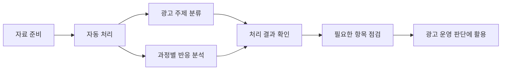
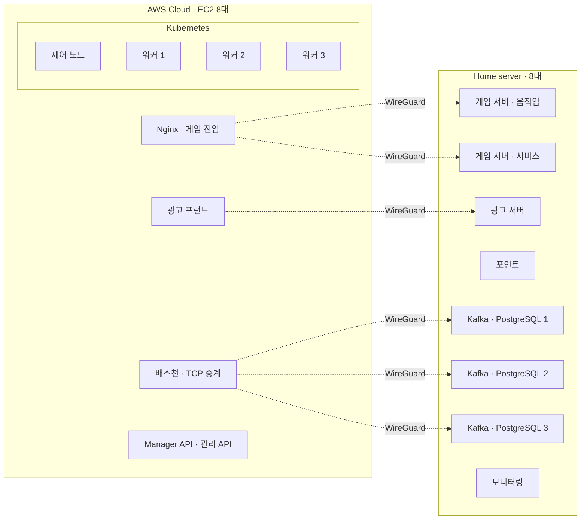
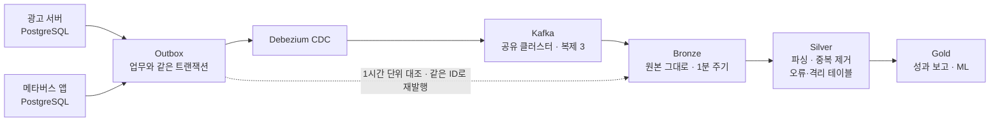

# 과정 별 맞춤 광고 송출

> PLAYDATA METAVERSE 캠퍼스에 광고를 내보내고, 광고의 주제와 교육 과정별 반응을 정리해 어떤 광고를 보여줄지 판단할 근거를 만드는 프로젝트

- 진행 기간: 2026.11.10(화) ~ 2026.11.12(목)
- 팀명: mlo-01-p4-team2
- 팀원: 강한솔, 김남동, 신동엽, 이재원, 조성현

## 목차

1. [서비스 소개 및 기획](#1-서비스-소개-및-기획)
2. [인프라](#2-인프라)
3. [데이터 파이프라인](#3-데이터-파이프라인)
4. [머신러닝](#4-머신러닝)
5. [모니터링](#5-모니터링)
6. [성능 측정 및 최적화](#6-성능-측정-및-최적화)
7. [저장소 구성](#7-저장소-구성)
8. [브랜치와 커밋 규칙](#8-브랜치와-커밋-규칙)

---

## 1. 서비스 소개 및 기획

### PLAYDATA METAVERSE — 함께 머물고 배우는 이벤트 캠퍼스

PLAYDATA 캠퍼스를 옮겨 온 실시간 메타버스입니다. 닉네임과 캐릭터로 18층 캠퍼스와 옥상을 돌아다니며 채팅·찌르기로 인사하고, 학습교실에서 문제를 풀어 포인트를 모읍니다. 캠퍼스 곳곳의 광고판에는 광고 서버가 고른 광고가 나옵니다.

### 광고 서비스 — 광고와 교육 과정의 연결을 돕는 서비스

광고의 주제와 교육 과정별 반응을 정리해, 운영자가 어떤 광고를 보여줄지 판단할 때 참고할 정보를 제공합니다.

| 광고 주제 파악 | 과정별 반응 확인 | 운영 기준 제공 |
|---|---|---|
| 광고가 다루는 주제를 분류 | 교육 과정별 관심과 반응을 살펴봄 | 운영자가 활용할 수 있는 기준으로 정리 |

**기획 배경 및 목표** — 광고를 하나씩 확인하고 정리하는 반복 업무를 줄이는 것

- 일관된 분류: 광고를 공통된 주제 기준으로 관리
- 과정별 특성 고려: 교육 과정마다 다른 반응을 운영 판단에 활용
- 관리 편의성 향상: 처리 결과와 확인이 필요한 항목을 구분

**이용 흐름**

**기대효과와 한계**

- 업무 효율: 광고를 개별적으로 확인하고 정리하는 부담 감소
- 관리 품질: 공통 기준에 따른 광고 정보 관리
- 운영 개선: 과정별 반응을 참고해 광고 운영 방향 검토
- 지금은 운영 기준을 만드는 단계이며, 광고 성과 향상은 아직 검증하지 않았습니다. 앞으로 실제 운영에서 분류 품질과 효과를 확인하고 광고 노출 방식 개선으로 이어갈 계획입니다.

---

## 2. 인프라

### 홈서버 · 클라우드 하이브리드 구축

AWS EC2 8대와 홈서버 8대를 WireGuard 터널로 잇습니다.

### 운영 환경 설정과 접근 관리

| 항목 | 내용 |
|---|---|
| WSL 구성·중단 대비 | Windows + WSL 환경을 구성하고 업데이트 중단 대비·WSL 자동 실행 적용 |
| 지정 IP·포트만 허용 | 접속할 IP와 필요한 서비스 포트를 지정해 관리 접근을 제한 |
| 개인별 키·권한 분리 | 개인별 SSH 키를 지급하고 업무에 필요한 계정 권한만 부여 |
| DHCP 불가 → 고정 IP | 공유기에서 DHCP 예약 설정이 불가해 서버에 고정 IP 사용 |

### 자동 복구와 장애 원인 추적

- WSL 복구: 8대, 1분 주기로 부팅 시·주기적 WSL 자동 실행
- 접속 갱신: 전달 포트 38개의 포트 프록시 갱신, 덤프 감시 후 재연결
- 충돌 기록: IP Helper 덤프 수집과 재발 조건 추적
- 남은 과제: IP Helper 충돌 원인 분석, DHCP 예약·관리 접근 예외 정리

---

## 3. 데이터 파이프라인

### 광고·메타버스 이벤트를 하나의 파이프라인으로

업무 DB에서 분석용 테이블까지, 유실·중복 없이 다시 만들 수 있게 설계했습니다.

- **평소 경로**: 읽은 위치 기록 4가지(복제 슬롯 · Connect offset · Spark checkpoint · Delta 트랜잭션)로 이어 읽습니다.
- **안전망**: outbox를 정답으로 두고 1시간 단위로 Bronze와 대조합니다. 어긋나면 outbox에서 같은 ID로 재발행하고, 중복은 Silver가 ID로 하나만 남깁니다. 확인 전에는 소스를 지우지 않습니다.
- **저장소**: S3 위의 Delta Lake(Parquet 데이터 파일 + 변경·버전 기록). 학습 데이터는 정해진 시점에 모아 읽으므로 상시 DB 대신 객체 저장소와 Spark 연산을 분리했습니다.
- **현재 상태**: Bronze는 운영 Kubernetes에서 가동 중입니다. Silver·Gold는 코드·시험·리뷰를 마쳤고 2차 배포를 준비하고 있습니다.

### 서로 다른 초안을 하나로

광고와 메타버스는 처음에 서로 다른 초안으로 출발했고, "같은 이벤트 = 같은 ID"와 "알아채지 못하는 유실 0"을 지키는 쪽으로 통합했습니다.

| 항목 | 광고 초안 | 메타버스 초안 | 통합안 |
|---|---|---|---|
| 소스 DB | PostgreSQL | MySQL | PostgreSQL 3노드 · DB 2개 |
| 변경 수집(CDC) | outbox + Debezium CDC | 업무 테이블 CDC + Java SMT | 두 소스 모두 outbox CDC |
| 이벤트 ID | UUIDv5 · 행에서 결정 | UUIDv4 · 처리마다 새로 | 소스가 정한 ID 그대로 |
| 오류 처리 | 커넥터 멈춤 | 오류 토픽 + 건너뜀 | 모두 멈춤 · 오류 테이블 |
| 중복 제거 | Silver에서 event_id | Gold에서 distinct() | Silver MERGE(event_id) |
| 검증 | outbox ↔ Bronze 대조 | 테스트 때 계층별 건수 비교 | 두 소스 같은 방식으로 대조 |

**SMT를 떼고 Outbox를 택한 이유**

- SMT를 유지하면 처리마다 ID가 새로 생겨 재발행 때 같은 이벤트를 하나로 묶을 수 없고, 오류 처리 중 다시 실패하면 레코드를 버리고 위치만 확정해 알아채지 못하는 유실이 생깁니다. 값을 감싸 outbox와 내용을 비교할 수도 없습니다.
- Outbox는 업무 변경과 같은 트랜잭션에 이벤트를 남기므로, 업무가 커밋되면 이벤트도 반드시 남습니다. 원본 그대로 Bronze에 쌓아 outbox와 건수·해시로 비교하고, 빠지면 재발행합니다.
- SMT 없이 업무 테이블만 읽으면 메타버스 이벤트 15종 가운데 11종만 만들 수 있습니다(2종은 덮어쓰기라 이력이 사라지고, 2종은 업무 행이 없어 만들 수 없음).

**함께 정한 선택**

| 결정 | 이유 |
|---|---|
| Kafka 키 = 이벤트 ID | aggregate_id로 두면 재발행 68,440행 중 16,489행만 도착 |
| Kafka 값 = Debezium 메시지 그대로 | Bronze 행만으로 출처·위치 추적, 파싱은 Silver 어댑터 |
| 오류면 커넥터 멈춤 | 건너뛰면 곧 알아채지 못하는 유실 |
| Silver에서 ID로 하나만 | Silver를 바로 읽는 ML이 두 번 세지 않게 |
| 유령 이벤트는 격리 테이블로 | DB엔 없는 이벤트도 지우지 않음, Gold는 메인 테이블만 집계 |
| Kafka·Connect 공유, Silver·Gold 소스별 | 커스텀 코드가 없어 공유 위험 없음 · 교차 분석은 안 함 |

### 무엇이 죽었다 살아나도 유실이 없도록

| 구간 | 장애 가정 | 장치 |
|---|---|---|
| PostgreSQL | 서버 다운 · 주 서버 교체 | 3노드 Patroni · 동기 복제 · failover 슬롯(위치 보존) |
| Debezium · Connect | 프로세스 종료 · 옛 연결이 슬롯 점유 | Source EOS · 슬롯 재시도 3분 · 위치가 어긋나면 멈춤 |
| Kafka | 브로커 다운 · 전체 정지 | 복제 3 · 최소 ISR 2 · 데이터가 사라지면 Bronze가 멈춤 |
| S3 · Bronze | 쓰기 실패 · Spark 드라이버 종료 | checkpoint + Delta 트랜잭션 · writer 하나로 제한 · 재시작 Always |

| 구분 | 확인한 숫자 |
|---|---|
| 운영 확인(2026.11.10) | 광고 outbox 13 = Kafka 13, 메타버스 outbox 54,713 = Kafka 고유 54,713, 중복 0 |
| 테스트 환경 · 재발행 중 DB 주 서버 전환(16초) | 715,498행 빠짐 0 · 중복 0 |
| 테스트 환경 · 이벤트 생성 → Bronze | p99 60.2초 |

운영 숫자는 확인한 시점의 건수이며, 운영 전체 기간의 값은 아닙니다.

### 같은 ID로 정합성을 확인

`outbox = Bronze = Silver + 오류(+격리)`가 한 줄로 이어지게, 모든 단계를 같은 이벤트 ID로 맞춥니다.

- 대조 ① outbox ↔ Bronze: 1시간 단위로 ID 수·해시 비교, 빈 구간은 같은 ID로 재발행
- 대조 ② Bronze ↔ Silver: Silver가 처리를 끝낸 Bronze 버전을 고정해 구간마다 비교
- 판정: `match`(통과) / `mismatch`(ID가 빠졌거나 겹침 → 종료 코드 3 + 경보, 그 구간은 Gold 미확정) / `copies_mismatch`(ID는 같고 중복 수만 늘어남 → 경보)
- Gold는 합계가 Silver 건수와 같을 때만 씁니다.
- Delta의 멱등 쓰기는 같은 배치를 두 번 써도 한 번만 반영하지만, 변환 중 행이 사라지거나 설정 실수로 건수가 두 배가 되는 것은 막지 못합니다. 그 빈틈을 대조가 잡습니다.

### 조건부 무결성을 위해 PostgreSQL로

| 얻은 것 · DB가 직접 지키는 무결성 | 잃은 것 · 운영이 떠안은 몫 |
|---|---|
| 조건부 유일 제약(지갑당 가입 지급 1회 · 캠페인당 열린 심사 1건) | MySQL Router가 맡던 failover·쓰기 라우팅 |
| MySQL용 우회 구조 제거(생성 열 2개 삭제 · 잠금 2질의 → 1질의) | Patroni + etcd 3대 + HAProxy + 슬롯 동기 스크립트를 직접 조립 |
| WAL 논리 복제로 outbox CDC(failover 슬롯 — 주 서버가 바뀌어도 위치 유지) | 구성 요소 증가, 슬롯 보호 목록·collation 버전까지 관리 |

### 초안 설계에서 검토한 기반 기술

메타버스 초안은 MySQL Group Replication(3대 중 1대 장애 허용), GTID·binlog 보존(7일), Kafka Source EOS와 read_committed 소비, Kafka Connect 분산 Worker의 태스크 인계, Spark Operator의 Driver 재실행(최대 3회), Bronze·Silver·Gold 앱별 독립 실행 주기를 검토했습니다. 통합안에서는 소스가 PostgreSQL + outbox로 바뀌었고, 분산 Connect Worker, S3 위 Delta Lake, checkpoint와 Delta 멱등 쓰기, 계층별 독립 Spark 앱은 그대로 이어받았습니다.

---

## 4. 머신러닝

과정 별 맞춤 광고 송출을 위한 데이터 분류 로직입니다. 모델 코드는 이 저장소에 포함되어 있지 않고, 이 저장소에는 결과를 받는 쪽이 있습니다.

| 확인 범위 | Laya 분류 (광고 주제) | MLPRegressor 가중치 (과정별) |
|---|---|---|
| 구현 시험 | 기본 시험 71개 통과 | 시험 63개 통과 |
| 모델 실행 | 실제 Laya로 로컬 추론 | 실제 MLP와 로컬 Delta 사용 |
| 외부 연동 | 광고 서버·OpenAI 미검증 | 실제 S3·광고 서버 미검증 |
| 운영 적용 | 실제 서버와 예약 작업 미배포 | 실제 서버와 예약 작업 미배포 |

- 광고 서버는 광고마다 카테고리(8비트 비트마스크)와 과정별 노출 가중치(MLO · AIO · SKN, 각 0~100)를 저장하고, 외부 분류·가중치 모듈이 내부 입력 API로 값을 넣습니다.
- Gold ML 테이블은 하루 × 광고마다 그날의 카테고리와 과정별 클릭 수·클릭률·전환율을 제공합니다.
- 가중치는 저장까지 구현했고, 실제 광고 선택에는 아직 사용하지 않습니다.
- 성과 개선, 최적 가중치, 실제 광고의 분류 정확도는 검증하지 않았습니다.

---

## 5. 모니터링

| 대시보드 | 내용 |
|---|---|
| 매니저·보상 지급 | 계정 발급·미션 달성 확인·보상 지급 기록을 한 화면에서 처리. 과정·기수로 대상을 찾고 지급 상태를 확인, 명단은 CSV로 내려받아 현장에서 활용 |
| 이벤트 결과 리포트 | DB에 저장된 빼빼로·타격·미션·게임 기록으로 참여 인원, 순위, 시간대별 추이와 게임 인기도 집계 |

데이터 파이프라인은 1분마다 복제 슬롯·복제·커넥터·Kafka ISR·Bronze 신선도·디스크·outbox 크기·앱 → DB 연결을 감시합니다([pipeline/monitor](pipeline/monitor/README.md)).

---

## 6. 성능 측정 및 최적화

### 최적화

| 영역 | 내용 | 결과 |
|---|---|---|
| 실시간 처리 | 주변 사용자에게 필요한 위치·상태만 전송, 이동 검증과 서버 일시정지 처리의 중복 작업 축소, 늦게 도착한 입력 정리 | 아래 성능 ① |
| 입장 로딩 순서 | 시작 층 이미지를 먼저 준비하고 초기 요청을 3개로 제한, 나머지는 뒤에서 로딩 | 첫 접속 23.4 → 11.6초, 입장 이미지 51.6 → 25.0MB, 맵 표시 후 5초간 끊김 15 → 0회 |
| 이미지 WebP 경량화 | 캐릭터·NPC·장식 이미지 34개를 WebP로 바꾸고 입장 로더가 최적화 파일 사용 | 첫 접속 11.7 → 6.6초(약 44%↓), 입장 이미지 25 → 11.4MB(약 54%↓) |
| ROOM·게임 장치 배치 | 벽과 장치·안내 표식이 겹쳐 가리던 것을 위치·투영·간격 조정으로 수정 | 2개 ROOM(분석 장치 2개 · 제작 단계 5개) |
| CQRS · 게시판 읽기/쓰기 분리 | 조회 → 세컨더리, 쓰기 → 주 DB | 목록 응답 P95 1,402 → 941ms(약 33%↓), DB 작업 지연 경고 833.5 → 0.7건/분 |

입장 로딩과 WebP는 각각 따로 측정한 값입니다. 게시판 비교는 100명 부하 기준이며, 이전·이후의 시험 시간(154초 / 86초)과 이동 입력량이 다릅니다.

### 성능 ① 이전 병목과 개선 (로컬)

| 조건 | 지표 | 전 → 후 |
|---|---|---|
| 동일 로컬 조건 · 20명 | CPU 사용률 | 98% → 32% |
| | 키 입력 → 이동 P95 | 2,197 → 7ms |
| | 다른 사람 위치 간격 P95 | 2,511 → 116ms |
| 로컬 100명 접속 시도 | 접속 완료 | 18 / 100명 → 100 / 100명 |
| | 프로세스 CPU | 99% → 71% |

과거 로컬 이동 시나리오 기준이며, 최신 온프레미스 시험과는 환경이 다릅니다.

### 성능 ② 현재 서버 규모 (온프레미스)

| 시도 | 연결 | 전송 시도(회/초) | 비고 |
|---|---|---|---|
| 50명 초기 | 50 / 50 | 300 | 완료 |
| 100명 재시도 | 62 / 100 | — | 502 21건 |
| 120명 목표 | 120 / 120 | 720 | 전원 연결 |
| 200명 시도 | 104 / 200 | 923 | 연결 제한 |

회/초는 HTTP + 발신 WebSocket 전송 시도 수이며 서버 TPS가 아닙니다. 200명은 19초 안정 구간 기준입니다. 120명 연결은 확인했지만 강의실 경로 상호작용 오류가 있었고, 게시판·브라우저·광고는 측정하지 않았습니다.

---

## 7. 저장소 구성

| 폴더 | 내용 | 문서 |
|---|---|---|
| `platform_server/` | 메타버스(Django Channels): 실시간 이동·채팅, 학습교실, 포인트, 게시판, 광고 연동(`ad-bridge/`), 부하 시험, 배포 스크립트 | [README](platform_server/README.md) · [실행 가이드](platform_server/RUN_GUIDE.md) |
| `ads_server/` | 광고 서버(Django): 캠페인·광고·소재 관리, 매체 노출·반응 API, 과정 코드 타게팅, 포인트 과금, outbox 이벤트, 내부 입력 API | [README](docs/legacy/ads-server/README.md) |
| `ads_frontend/` | 광고주·운영자 웹 화면 | [README](ads_frontend/README.md) |
| `pipeline/` | outbox → Debezium → Kafka → Bronze → Silver → Gold, 대조·재발행 도구, 감시, 운영 절차 | [README](pipeline/README.md) · [운영 절차](pipeline/runbooks/README.md) |
| `docs/` | 광고 서버 설계·DRD·API 계약·위협 모델, PostgreSQL 전환 계획 | [설계](docs/legacy/ads-server/ads-server-design.md) · [DRD](docs/legacy/ads-server/ads-server-drd.md) · [계약](docs/legacy/ads-server/contracts/README.md) · [위협 모델](docs/legacy/ads-server/threat-model.md) · [전환 계획](docs/plans/00_PostgreSQL_Migration_and_Outbox_Extension.md) |

## 8. 브랜치와 커밋 규칙

| 브랜치 | 용도 |
|---|---|
| `main` | 배포 기준. `dev`에서 검증한 것만 합친다 |
| `dev` | 개발. 기능 브랜치는 `dev`에서 나와 `dev`로 합친다 |
| `feat/<이슈 번호>` | 이슈 하나의 작업 |

- 커밋 메시지: `[Add|Mod|Refactor|Doc] 설명 (#이슈 번호)`
- 순서: 이슈 → `feat/<이슈 번호>` 브랜치 → PR(`dev`) → 리뷰 후 병합 → 검증된 `dev`를 `main`으로
