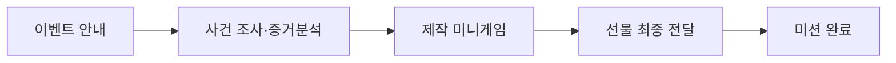

# PLAYDATA 메타버스 빼빼로데이 이벤트 추진 기안서 v1

## 목차

1. [문서 개요](#section-1)
2. [핵심 요약 (Executive Summary)](#section-2)
3. [기획 배경 및 추진 필요성](#section-3)
4. [이벤트 서비스 정의](#section-4)
5. [핵심 사용자 경험 및 참여 흐름](#section-5)
6. [추진 목표 및 KPI](#section-6)
7. [운영 범위·일정·예산](#section-7)
8. [기대 효과 및 주요 위험](#section-8)
9. [승인 범위 및 집행 기준](#section-9)

## 1. 문서 개요

| 항목 | 내용 |
|---|---|
| 문서 유형 | 이벤트 추진 승인 기안서 |
| 문서 기준 시점 | 2026.11.11 행사 시작 전 |
| 버전·승인 상태 | v1 / **승인** |
| 행사명 | PLAYDATA 메타버스 빼빼로데이 이벤트 「사라진 11번째 빼빼로」 |
| 승인권자 | 손승진 팀장 |
| 결재일 | 2026.10.30 |
| 기안자 | 강한솔 |
| 운영 기준 점검 | 행사 준비 단계에서 담당자 지정 및 역할 배정 |
| 추진 계기 | 강사·매니저의 이벤트 요청 |
| 승인 범위 | 행사 추진·서비스 방향·운영 범위·일정·경품 구매 예산 |

- 기획 담당 — 요구사항·참여 흐름·운영 정책·KPI 구체화
- 개발·인프라 운영·경품 구매 및 지급 — 업무별 담당자 배정
- 세부 실행 기준 — 기획·운영명세 적용

## 2. 핵심 요약 (Executive Summary)

**기존 메타버스 공간·콘텐츠를 활용한 기간 한정 공동 미션**

- 과정 간 교류 기회 마련
- 수업 시간 보호와 미션 완료·경품 지급 기준 통일

| 항목 | 추진 내용 |
|---|---|
| 참여 대상 | PLAYDATA 부트캠프 수강생 |
| 핵심 경험 | 꾸왕이와 사건 조사 → 증거 분석 → 제작 → 선물 전달 |
| 제공 범위 | 메인 미션, 이스터에그 11종, 참여·진행·완료 관리, 경품, 외부 만족도 설문 |
| 운영 일정 | 11/11 지정된 수업 외 시간에 메인 미션·이스터에그 운영, 20:00 종료 |
| 평가 지표 | 방문·참여·완료율·전반 만족도 |
| 경품 구매 | 빼빼로 84개·초코킥 30개, 총 114개 / 승인 예산 **120,090원** |

## 3. 기획 배경 및 추진 필요성

### 3.1 추진 배경

- 강사·매니저의 빼빼로데이 행사 요청
- 기존 이동·대화·게임·학습 콘텐츠를 활용한 공동 사건 조사

### 3.2 추진 필요성

| 과제 | 필요한 조치 |
|---|---|
| 행사 서비스 구체화 | 참여 대상·콘텐츠·동선·단계별 행동 정의, 기획·개발·운영 공통 기준 마련 |
| 참여·완료·보상 기준 정리 | 접속과 등록, 완료와 경품 지급 구분 및 판정·기록 기준 통일 |
| 교육 일정 보호 | 수업 외 이용 시간과 중단·재접속 처리 기준 마련 |
| 행사 평가 준비 | 방문·등록·완료 지표 및 설문 문항 정의, 결과 보고 담당 지정 |

## 4. 이벤트 서비스 정의

| 항목 | 정의 |
|---|---|
| 서비스 목적 | 스토리형 미션을 통한 공동 참여, 메타버스 콘텐츠 체험, 교육생 간 교류 기회 제공 |
| 사용자 | 부트캠프 수강생. 대상 과정과 계정 자격은 운영 책임자 확인 |
| 주요 공간 | 18층, 옥상, 증거분석실, 쇼콜라 제작실 등 |
| 핵심 콘텐츠 | 사건 조사부터 선물 전달까지 이어지는 메인 미션과 이스터에그 11종 |
| 운영 지원 | 안내·문의, 이용 시간 통제, 진행 보존, 판정·지급 관리, 만족도 설문과 보고 |
| 사용자 가치 | 시작 방법과 다음 행동 파악, 중단 후 진행 재개 |

**제외 범위**

- 광고 플랫폼 사업화, 신규 플랫폼 구축, 개인 학습 컨설팅 확정, 상시 서비스 확대

## 5. 핵심 사용자 경험 및 참여 흐름

### 5.1 참여 흐름

### 5.2 참여·운영 기준

| 상황 | 운영 기준 |
|---|---|
| 참여 등록 | 운영명세에 명시된 참여 행동과 등록 시점 적용 |
| 중복 요청 | 운영명세의 식별·판정 기준에 따라 기록과 집계의 중복 방지 |
| 미션 진행 | 현재 단계·다음 목적지 안내, 운영명세에 따른 단계별 진행과 최종 전달 판정 |
| 중단·재접속 | 완료 단계 보존, 이용 가능 시간 내 미완료 단계 재시도 |
| 수업 시작 | 시작 1분 전 경고 후 활동 중단, 확정 기록 보존 |
| 행사 종료 | 종료 후 신규 완료·달성·경품 자격 불인정, 기존 기록 확인 및 경품 지급 처리 |
| 설문 참여 | 외부 Google Forms에서 수집·관리, 문항별 집계와 비식별 의견 요약 |

- 개시 전 점검 — 적용 명세 버전, 점검 담당자, 참여·재시도·복구·경품 기준의 안내문 반영 여부

## 6. 추진 목표 및 KPI

- 수치 목표와 집계 기준의 근거 확인 및 평가 계획 기록

| 평가 지표 | 지표 정의 | 평가 계획에 명시할 항목 |
|---|---|---|
| 서비스 유입 | 활동 기록이 있는 고유 계정 | 목표값, 집계 기간, 관리자 포함·시험 계정 제외 기준 |
| 메인 참여 | 등록 기준에 해당하는 고유 계정 | 목표값, 참여 등록 시점·중복 집계 방지 기준 |
| 메인 완료율 | (최종 전달 완료 고유 계정 ÷ 메인 등록 고유 계정) × 100 | 목표값, 완료·등록의 집계 기준, 동일 모집단 적용 |
| 전반 만족도 | 전반 만족도 문항의 유효 응답 평균 점수 | 목표값, 문항·척도·산식 |
| 설문 집계 | 제출 건수·문항별 유효 건수·평균·긍정 응답 비율 | 건수 목표와 항목별 정의 |
| 운영 안정성 | 장애 건수·복구 시간·영향 계정·조치 완료 여부 | 수치 목표와 집계 기준 |

- 메인 운영 시간과 지표 집계 기간의 구분
- 기준 문서의 작성일·적용 시점 확인 및 집계 담당자 전달

- 설문 집계 단위 — 제출 건수·문항별 유효 응답 건수. 계정 기준 집계와 구분
- 응답률 목표 적용 조건 — 고유 응답자 수와 분모 확인
- 메인 등록 계정 0건 시 완료율 산출 불가

- 설문 구성 — 콘텐츠·전반 만족도, 이동·조작, 안내 이해도, 스토리 몰입, 자유 의견
- 개시 전 운영명세 기재 항목 — 문항·수집 항목·기간·권한·공개 범위

## 7. 운영 범위·일정·예산

### 7.1 운영 일정

| 구간 | 운영 일정과 실행 내용 |
|---|---|
| 사전 준비·안내 | 11/6 공식 교육과정 채널을 통한 홍보, 11/9~10 공간·안내 운영 및 행사 준비 |
| 메인 운영 | 11/11 지정된 수업 외 시간에 메인 미션·이스터에그 진행 |
| 종료 | **11/11 20:00 종료, 연장 없음** |
| 다음 날 운영 | 11/12 수업 외 자유 이용, 확정 기록 확인·경품 처리. 메인·이스터에그 신규 진행 불가 |
| 설문 | 11/11~12 운영. 시작·마감 시각과 제출·수정 종료 방식은 설문 운영 안내 기준 적용 |
| 보고 | 종료 후 7일 이내 설문 요약 공개, 11/21까지 운영자 상세본·참여자 요약본 작성. 산출물별 일정·담당은 보고 계획 기준 적용 |

**메인 이용 시간**

- 오전 — 08:30~09:00
- 쉬는 시간 — 09:50~10:00, 10:50~11:00, 11:50~12:00, 14:50~15:00, 15:50~16:00, 16:50~17:00
- 점심 — 12:50~14:00
- 저녁 — 17:50~20:00
- 수업 중 일반 메타버스 이용 제한

- 행사 공지 — 기간·참여 방법·경품·스토리 도입부 안내, 정답·숨은 조건 비공개
- 공지 계획 — 채널별 게시 담당·발송 시점·결과 공개 경로 명시

- 운영 담당 — 행사 총괄, 공지·문의, 서비스 대응, 판정·경품 지급, 집계·보고
- 인프라 — 노트북 4대와 AWS 병행 구성, 적용 전 장비별 역할·연동·접속 준비 점검 및 담당자 지정·비용 산정

### 7.2 경품 구매 예산 및 승인 범위

| 구매 품목 | 수량 |
|---|---:|
| 빼빼로 | 84개 |
| 초코킥 | 30개 |
| 합계 | **114개** |

- 승인 예산 — **120,090원**
- 구매 전 점검 — 품목별 단가·금액, 배송비 등 포함 비용, 결제 주체
- 추가 구매·증액 — 해당 예산의 집행 절차 적용

- 경품 지급 — 운영명세 적용. 구매 수량과 실제 지급 수량의 구분

| 구분 | 적용 기준 | 세부 운영 항목 |
|---|---|---|
| 지급 정책 | 승인된 구매 수량과 운영명세의 지급 기준 대조 | 지급 대상·품목·1인당 수량·선착순 범위·조건별 중복 수령 |
| 지급 관리 | 판정·발표·수령 업무 분담 및 지급 상태 기록 | 담당자·수령 기한·미수령 처리 |
| 인프라 비용 | 경품비와 구분하여 견적·사용 자원 관리 | 장비별 역할·사용 규모·금액·운영 담당 |

- 총사업비 — 경품비·인프라 비용 구분 집계. 인프라 예산의 집행 절차 별도 적용

## 8. 기대 효과 및 주요 위험

### 8.1 기대 효과

- 교육생 간 교류 및 메타버스 콘텐츠 체험 기회 확대
- 참여·완료·경품 기준 통일을 통한 운영 판단의 일관성 확보
- KPI와 설문을 활용한 참여·만족도 평가

### 8.2 개시 전 예상 위험과 대응

| 예상 위험 | 대응 계획 | 개시 전 확인 |
|---|---|---|
| 행사 인지·참여 부족 | 공식 채널 안내, 명확한 시작 방법과 참여 시간 고지 | 홍보 담당·공지 일정·접근 방법 |
| 수업 방해·참여 중 중단 | 수업 중 제한, 사전 경고, 확정 진행 보존 | 교육 시간표·중단·재접속 기준 |
| 이동·순서·참여 조건 혼동 | 현재 단계·다음 목적지 안내, 시작·완료 조건 일치 | 대표 참여 흐름의 사전 점검 |
| 중복 처리·경품 판정 분쟁 | 계정·기록 기준 통일, 순위·중복 당첨·지급 이력 관리 | 판정 책임·최종 지급 명세 |
| 접속 장애·진행 기록 유실 | 문의·장애 공지 담당 지정, 중단·복구·기록 보존 절차 준비 | 장비·연동 준비 및 복구 확인 책임 |
| 비용·재고 부족 | 승인된 구매 수량·지급 정책·필요 수량 대조, 예산 한도 확인 | 가격·배송비·재고·인프라 비용 |
| 설문·개인정보 해석 오류 | 최소한의 수집, 비식별 공개, 제출·계정 단위 구분 | 문항·권한·보관·마감·지표 정의 |

- 개시 전 남은 위험 — 행사 책임자의 영향 범위·대응 가능 여부 보고
- 장애·시간 제약 발생 시 종료 시각·경품 기준 변경 — 권한자 결정

## 9. 승인 범위 및 집행 기준

- 승인 범위 — 행사 추진·서비스 제공 범위·운영 일정·경품 구매

| 구분 | 운영·집행 기준 |
|---|---|
| 추진·대상 | 행사 책임자 지정, 대상 과정·계정 자격 확인 |
| 참여 운영 | 운영명세의 참여 등록·중복 집계·단계별 조건 적용 |
| 운영 일정 | 시간표·접근 제한 확인 및 종료 처리 담당 지정 |
| 평가 | 평가 계획의 수치 목표·집계 기간·계정 범위·설문 단위 적용 |
| 경품 구매 | 승인 예산 범위 내 집행, 구매 전 가격·포함 비용·결제 주체 확인 |
| 지급 정책 | 운영명세에 따른 지급 대상·수량·중복 수령 기준 적용 및 담당자 지정 |
| 인프라 | 사용 규모·금액·담당자 관리 및 해당 예산 집행 절차 적용 |
| 운영·보고 | 업무별 담당자 지정, 장애 보고 절차와 결과 공개 일정 관리 |

- 개시 전 점검 — 참여·지급·평가 기준, 운영 책임, 비용 조건
- 기준 미충족 시 개시 여부 — 승인권자 판단

- 운영 기준 공유 — 기획 담당의 운영명세·안내문 반영 및 개발·운영 담당자 전달

**검토 결과 — 승인**
