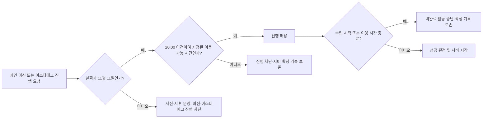

<a id="사라진-11번째-빼빼로--통합-이벤트-기획서"></a>

# 사라진 11번째 빼빼로 — 통합 이벤트 기획서

> **문서 단계:** Final Draft (최종 검토 완료)<br>**승인 상태:** 승인 / 확정<br>**행사:** PLAYDATA Bootcamp Metaverse<br>**전체 운영:** 2026.11.09~11.12 (사전 11.09~10 / 본 운영 11.11 / 사후 11.12)<br>**메인 미션·이스터에그:** 2026.11.11에만 진행 (20:00 종료)<br>**자유 탐색:** 2026.11.12<br>**최종 보고서:** 2026.11.21까지

<a id="핵심-요약"></a>

## 핵심 요약

| 항목 | 정책 |
| --- | --- |
| 고유 방문자 목표 | 80명 |
| 메인 이벤트 목표 | 40명 이상 |
| 메인 완료율 목표 | 등록 참여자 대비 50% 이상 |
| 설문 집계 | Google Forms 제출 건수 및 만족도 결과를 별도 집계 |
| 메인 미션 | 18층 꾸왕이 시작 → 옥상 증거분석실 → 18층 꾸왕이 → 옥상 쇼콜라 제작실 → 18층 꾸왕이 최종 전달 |
| 이스터에그 | 11종, 11.11에만 달성 가능; 꾸왕이 수사수첩에서 달성 현황 확인 (조건·위치는 운영진 전용) |
| 경품 | 구매 114개, 확정 지급 대상 112개(메인 90개·이스터에그 22개), 120,090원 |

## v2. 검토 및 실행 관리

이 표는 기존 정책을 변경하지 않고 협업과 검증을 돕기 위해 추가한 관리 항목입니다. 본문의 승인·확정 표기는 원문 기록이며, 아래 미결정 항목까지 모두 확정되었다는 뜻으로 해석하지 않습니다. 담당자, 기한, 이슈, 시험 결과는 확인 전입니다.

### 역할별 먼저 확인할 사항

- **기획·운영:** 대상과 일정, 참여·경품 기준, 미결정 사항, 장애 대응을 확인합니다.
- **개발:** 참여 등록, 미션 상태 저장·복구, 시간별 접근 제어, 서버 확정 기준과 예외를 확인합니다.
- **검증:** 본문 B3.3 체크리스트와 아래 요구사항을 대조하고 실제 결과를 기록합니다.

### 확정·미결정 및 담당 관리표

| 항목 | 문서상 상태 | 담당자 | 결정 기한 | 근거·비고 |
| --- | --- | --- | --- | --- |
| 참여 등록 기준 | 정책 기재 | 확인 필요 | 확인 필요 | 6.2: 꾸왕이 팝업의 등록 버튼 및 서버 확정 |
| 장비별 역할과 담당 | 미배정 | 확인 필요 | 확인 필요 | 3.3: 노트북 4대와 AWS 연동 검증 필요 |
| 이스터에그 경품 잔여 2개 | 미결정 | 확인 필요 | 확인 필요 | 3.1: 지급 대상·방식 미확정 |
| 설문 응답률 목표 | 재검토 | 확인 필요 | 확인 필요 | 5.2: 제출 건수는 고유 응답자 수와 다름 |
| 인프라 실제 비용 | 미산정 | 확인 필요 | 확인 필요 | 3.3: 실제 사용 규모 확인 필요 |

### 요구사항 추적표

아래 ID는 v2 관리용으로 부여한 식별자이며 기존 이슈와 자동 연동되지 않습니다. 문서의 확정 정책 및 원래 검증 체크리스트를 함께 확인합니다.

| ID · 요구사항 | 조건 및 예상 결과 | 본문 참조 | 개발 이슈 | 테스트 결과 |
| --- | --- | --- | --- | --- |
| EVT-REG-01 참여 등록 | 11.11 이용 가능 시간에 꾸왕이 팝업의 등록 버튼 클릭 시 서버 등록. 단순 팝업 열람은 등록 아님. | 6.2, B3.1 | 확인 필요 | 미확인 |
| EVT-END-01 이벤트 종료 | 11.11 20:00 이후 신규 완료·달성·경품 자격 차단. 11.12 신규 진행 차단 및 기존 확정 기록 보존. | 2, B3.2, B3.3 | 확인 필요 | 미확인 |
| EVT-REC-01 진행 복구 | 재접속 시 서버 확정 상태 복원. 수업 시작 시 미완료 활동 중단 및 확정 기록 보존. | 2.2, A5.2, B3.2 | 확인 필요 | 미확인 |
| EVT-REWARD-01 경품 확정 | 서버 확정 및 검증된 기록을 기준으로 선정하고 지급 상태를 관리. | 3, A5.3, B2.5 | 확인 필요 | 미확인 |

### 성과 목표 및 집계 기준

방문자 목표는 11월 11일~12일 14:00의 고유 접속 계정 기준으로 집계합니다. 메인 참여 등록 목표는 40명 이상, 완료율 목표는 등록자 대비 50% 이상, 전반 만족도 목표는 4.0/5 이상입니다. 실제 운영 결과는 별도 결과보고서에서 관리합니다.

### 데이터 요구사항 검토 후보

아래는 업무 규칙으로부터 도출한 검토 후보이며 실제 DB 설계·구현 결과가 아닙니다.

- 참여 등록: 계정, 이벤트, 서버 확정 시각과 중복 등록 기준
- 미션 진행·완료: 계정별 단계, 확정 상태, 완료 시각과 복구 기준
- 이스터에그: 종류별 달성 계정과 최초 달성 확정 기준
- 경품: 선정 근거와 안내·수령 확인·지급 상태 이력
- 지표: 등록·완료 집계 분모와 외부 설문 비연계 원칙

---

<a id="목차"></a>

## 목차

- [Part 1. 이벤트 기획서](#part-1-%EC%9D%B4%EB%B2%A4%ED%8A%B8-%EA%B8%B0%ED%9A%8D%EC%84%9C)
- [부록 A. 운영 가이드](#%EB%B6%80%EB%A1%9D-a-%EC%9A%B4%EC%98%81-%EA%B0%80%EC%9D%B4%EB%93%9C)
- [부록 B. 개발 가이드](#%EB%B6%80%EB%A1%9D-b-%EA%B0%9C%EB%B0%9C-%EA%B0%80%EC%9D%B4%EB%93%9C)

---

<a id="part-1-이벤트-기획서"></a>

# Part 1. 이벤트 기획서

<a id="1-기획-개요"></a>

## 1. 기획 개요

| 항목 | 내용 |
| --- | --- |
| 이벤트명 | 사라진 11번째 빼빼로 |
| 전체 운영 | **2026.11.09(월)~11.12(목)** |
| 메인 미션 및 이스터에그 | **11.11 하루만**, 지정된 수업 외 시간에 진행, **20:00 종료** |
| 사전·사후 운영 | 11.09~11.10 사전 운영, 11.12 사후 운영 (메인 미션·이스터에그 진행 불가) |
| 참여 대상 | 플레이데이터 부트캠프 수강생 |
| 진행 방식 | 꾸왕이 스토리 + 서브쿼리 메모리 분석기 + 수량표 조사 + 쇼콜라 제작 미니게임 + 이스터에그 |
| 최종 완료 | 18F Lounge2에서 꾸왕이에게 제작한 빼빼로 전달 후 **서버 저장 성공** |
| 운영 조직 | 운영진 공동 운영, 세부 담당자 배정 필요 |
| 최종 분석 보고서 | **2026.11.21까지 발행** |

<a id="11-배경과-목적"></a>

### 1.1. 배경과 목적

이벤트 공동 참여와 메타버스 내 대화를 통해 다른 반 교육생들과 자연스럽게 소통하고 친목을 쌓을 기회 제공한다.

<a id="12-목표와-kpi"></a>

### 1.2. 목표와 KPI

| 구분 | 지표 | 목표·기준 |
| --- | --- | --- |
| 서비스 유입 | 11.11 00:00~11.12 14:00 활동 기록이 있는 고유 계정 (관리자 포함, 부하테스트 계정 제외) | **80명** |
| 메인 참여 | 메인 미션 참여 등록 고유 계정 (18층 꾸왕이 상호작용 팝업 내 버튼 클릭) | **40명 이상** |
| 메인 완료율 | 최종 전달 완료 고유 계정 ÷ 메인 이벤트 고유 계정 ×100 | **50% 이상** |
| 설문 집계 | Google Forms 제출 건수 및 만족도 결과를 별도 집계 (메타버스 계정 연계 없음) | 기존 응답률 50% 목표는 별도 재검토 |
| 전체 만족도 | 설문 전반 만족도 Q3 평균 | **4.0/5 이상** |
| 운영 안정성 | 장애 건수, MTTR, 영향받은 계정 수, 최종 조치 완료율 | 운영 기록으로 집계 |

고유 계정 기준으로 중복을 제거한다. 전체 방문 80명과 메인 이벤트 40명은 서로 다른 지표다. 방문·참여 실시간 운영 통계는 운영진 전용이다.

---

<a id="2-일정과-운영-시간"></a>

## 2. 일정과 운영 시간

<a id="21-주요-일정"></a>

### 2.1. 주요 일정

| 일자 | 운영 내용 |
| --- | --- |
| 11.06 | 공식 교육과정 채널 사전 홍보 |
| 11.11 | 공식 채널 리마인드 |
| 11.09 08:30 ~ 11.10 | 테마 메타버스 사전 운영 (**메인 미션·이스터에그 진행 불가**) |
| 11.11 | **본 운영: 이날만** 지정 시간대 메인 미션·이스터에그 진행 |
| **11.11 20:00** | 메인 미션·이스터에그 최종 종료 (연장 없음) |
| 11.11~11.12 | 만족도 설문 운영 (별도 시작·종료 시각 지정 없음) |
| 11.12 | 테마 메타버스 사후 운영 (**메인 미션·이스터에그 진행 불가**) |
| **11.21까지** | 운영진용 상세본·참여자용 요약본 최종 분석 보고서 발행 |

**11.11 20:00 이후 운영 시간 연장은 하지 않는다.** 장애 발생 시에도 신규 완료·달성·경품 자격은 인정하지 않는다.

<a id="22-미션-이용-가능-시간"></a>

### 2.2. 미션 이용 가능 시간

**아래 시간표는 11.11 본 운영일에만 메인 미션·이스터에그에 적용한다.** 11.09~11.10 및 11.12에는 해당 콘텐츠를 진행할 수 없다.

| 구간 | 시간 |
| --- | --- |
| 오전 | 08:30~09:00 |
| 쉬는 시간 | 09:50~10:00 |
| 쉬는 시간 | 10:50~11:00 |
| 쉬는 시간 | 11:50~12:00 |
| 점심 | 12:50~14:00 |
| 쉬는 시간 | 14:50~15:00 |
| 쉬는 시간 | 15:50~16:00 |
| 쉬는 시간 | 16:50~17:00 |
| 저녁 | 17:50~20:00 (11.11 본 운영일 기준) |

- **수업 시간에는 메인 미션·이스터에그 진행뿐 아니라 일반 메타버스 이용 자체를 차단한다.**
- **메인 미션**: 서버에 저장된 단계·세부 단계는 재접속 후 복구한다. 수업 시작 1분 전 경고 후 수업 시작 시 진행 중 미니게임을 중단한다. 이미 서버에 확정된 단계는 보존하며 미완료 라운드는 다음 이용 가능 시간에 재시도한다.
- 이벤트 최종 종료 시각은 **11.11 20:00이며 연장하지 않는다.**

---

<a id="3-경품과-예산"></a>

## 3. 경품과 예산

<a id="31-경품-구성-및-예산"></a>

### 3.1. 경품 구성 및 예산

| 구분 | 선착순 조건 | 경품명 | 수량 | 단가 | 금액 | 구매처 | 링크 |
| --- | --- | --- | --- | --- | --- | --- | --- |
| **메인미션** | 최초 최종 전달 확정 1~60위 | 빼빼로 | 60개 | 1,215원 | 72,900원 | 쿠팡 | [상품 확인](https://www.coupang.com/vp/products/9247844658?itemId=19911264301&vendorItemId=91372250550&q=%EB%B9%BC%EB%B9%BC%EB%A1%9C&searchId=16c8e0707721733&sourceType=search&rank=25&itemsCount=59&searchRank=25&traceId=mw1r0crr) |
|  | 최초 최종 전달 확정 61~90위 | 초코킥 | 30개 | 309원 | 9,270원 | 쿠팡 | [상품 확인](https://www.coupang.com/vp/products/8774356123?itemId=25675337841&vendorItemId=96177835299&q=%EC%B4%88%EC%BD%94%ED%82%A5&searchId=ad92c1765991769&sourceType=search&rank=7&itemsCount=60&searchRank=7&traceId=mw1ulbpp) |
| **소계** |  |  | **90개** | — | **82,170원** |  |  |
| **이스터에그** | 최초 달성 서로 다른 11계정에 각 2개 지급 (22개 지급·24개 구매) | 빼빼로 | 24개 | 1,580원 | 37,920원 | 쿠팡 | [상품 확인](https://www.coupang.com/vp/products/9740259630?vendorItemId=96075601491&sourceType=SDP_ALSO_VIEWED) |
| **소계** |  |  | **24개** | — | **37,920원** |  |  |
| **총합계** |  |  | **114개** | — | **120,090원** |  |  |

- **경품 총 구매 114개, 확정 지급 대상 112개(메인 90개·이스터에그 22개).** 이스터에그 구매분 24개 중 22개를 선착순 11계정에 각 2개씩 지급하며, 나머지 2개의 지급 대상·방식은 확정되지 않았다.
- 메인 경품은 **최초 완료 90명**까지만 지급한다.
- 메인 미션은 경품 대상 90명이 확정된 후에도 계속 참여할 수 있다.
- 이스터에그 경품은 최초 달성 서로 다른 11계정에 계정당 2개씩 **총 22개 지급**한다. **구매 수량은 24개**이며, 나머지 2개의 지급 대상·방식은 확정되지 않았다. 메인 경품과 **중복 당첨 가능**.
- 동시 요청 시 서버 원자적 확정·기록 시각으로 순위를 정한다.
- 경품 잔여 수량·당첨 여부를 실시간 공개하지 않는다.

<a id="32-경품-발표지급"></a>

### 3.2. 경품 발표·지급

- **11.12** 매니저가 서버 검증 결과를 바탕으로 당첨자를 발표한다.
- 발표 시간·공개 범위·수령 및 지급 방식은 매니저가 운영한다.
- 경품 상태: **당첨 확정 → 수령 안내 → 수령 확인 → 지급 완료**.
- 최초 수령 기한: 당첨자에게 **최초 수령 안내를 제공한 시점부터 3일**. 최초 안내 시각을 기록한다.
- 미수령 시 개별 알림 **1회**, 추가 **7일** 기한 제공.
- 최종 미수령은 운영진이 개별 판단하며 자동 재배정하지 않는다.
- 메인·이스터에그 중복 당첨자는 두 경품의 지급 이력을 별도로 관리한다.

<a id="33-인프라-운영-방안-및-비용-검토"></a>

### 3.3. 인프라 운영 방안 및 비용 검토

**운영 방식: 하이브리드(운영진 노트북 4대 + AWS 인프라 병행)**

| 운영 방식 | 구성 | 인프라 비용 | 비고 |
| --- | --- | --- | --- |
| 하이브리드 | 운영진 노트북 4대 및 AWS 인프라 병행 | 미산정 | 장비별 역할 분담·AWS 사용 규모·실제 운영비는 운영 환경에 따라 산정 |

운영진 노트북 4대의 장비별 역할·담당자는 미배정이며, 행사 시작 전 배정 및 연동 검증이 필요하다. 안정적인 운영을 위해 **동시 접속 부하, 네트워크 상태, 장애 복구 및 서버 연동**을 사전에 검증한다. 세부 역할 분담과 실제 인프라 비용은 검증 결과에 따라 정한다.

---

<a id="4-홍보-및-커뮤니케이션"></a>

## 4. 홍보 및 커뮤니케이션

- **11.06:** 공식 교육과정 채널 최초 홍보.
- **11.11:** 본 운영 시작 리마인드.
- 사전 홍보에는 제목, 기간, 참여 방법, 경품, 스토리 도입부, 이스터에그 11종 이름을 포함.
- 스토리 정답·달성 조건·미션 공략은 스포일러 방지를 위해 공개하지 않는다.
- 이벤트 중 일반 안내는 메타버스 팝업·게시판과 공식 채널을 사용한다.
- 장애 공지는 별도 장애 대응 절차에 따른다.

---

<a id="5-만족도-설문"></a>

## 5. 만족도 설문

<a id="51-운영-정책"></a>

### 5.1. 운영 정책

| 항목 | 확정 정책 |
| --- | --- |
| 방식 | **Google Forms (외부 설문)** |
| 진입 | **디스코드 안내** |
| 기간 | **2026.11.11~11.12** |
| 시작·종료 시각 | 별도 지정 없음 (기간 내 운영) |
| 응답 저장 | Google Forms에서 관리 |
| 응답 집계 | Google Forms 결과 기준 |
| 결과 공개 | 설문 종료 후 **7일 이내**, 메타버스 게시판 + 공식 채널 |

설문은 **11.11~11.12** 운영하며 별도 시작·종료 시각은 지정하지 않는다. 마감 후에는 신규 제출·수정·재제출을 차단한다.

<a id="52-설문-문항"></a>

### 5.2. 설문 문항

실제 설문에서 사용한 문항입니다. 전반 만족도는 Q3을 기준으로 집계합니다.

| 문항 | 내용 |
| --- | --- |
| Q1 | 현재 수강 중인 과정과 기수를 선택해 주세요. |
| Q2 | 이용한 콘텐츠가 있으신가요? |
| Q2-1 | 다른 접속자와의 상호작용(찌르기, 방어, 점프 등)에 얼마나 만족하셨나요? |
| Q2-2 | 커뮤니티(채팅, 게시판)에 얼마나 만족하셨나요? |
| Q2-3 | 18층 게임(코드타이핑, 11.11초 타이머, 페어링 정원)에 얼마나 만족하셨나요? |
| Q2-4 | 학습교실(Python, SQL, CS)에 얼마나 만족하셨나요? |
| Q2-5 | 메인미션에 얼마나 만족하셨나요? |
| Q2-6 | 이스터에그에 얼마나 만족하셨나요? |
| Q3 | 이벤트 전반에 얼마나 만족하셨나요? |
| Q4 | 메타버스 이동과 조작은 편리했나요? |
| Q5 | 미션 안내를 이해하기 쉬웠나요? |
| Q6 | 이벤트 스토리에 얼마나 몰입하셨나요? |
| Q7 | 불편했던 점이나 개선 의견을 자유롭게 적어주세요. |

- Q3 전반 만족도 목표 평균은 **4.0/5 이상**입니다.
- Q2-1~Q2-6, Q4~Q6은 문항별 평균과 긍정 응답(4~5점) 비율을 집계하되 목표 수치는 별도로 설정하지 않았습니다.
- Q7 자유 의견은 이동·조작 / 안내 / 콘텐츠 / 성능·오류 / 기타로 다중 분류할 수 있습니다.
- 설문 응답률 목표 50% 이상은 재검토 대상입니다. Google Forms 제출 건수는 고유 응답자 수로 해석하지 않습니다.
- 참여자 공개 내용은 응답 건수, 평균 만족도, 주요 결과 및 비식별화된 의견 요약입니다.

---

<a id="6-이벤트-스토리와-참여-등록"></a>

## 6. 이벤트 스토리와 참여 등록

<a id="61-스토리진행-흐름"></a>

### 6.1. 스토리·진행 흐름

11.11 메타버스 접속 → 이벤트 안내 팝업 → **18층 꾸왕이**와 상호작용하여 메인 미션 시작 팝업 → **옥상 증거분석실**의 서브쿼리 메모리 분석기 게임 → 같은 증거분석실의 **수량표 A/B/C 팝업** → **18층 꾸왕이** 고백 듣기 및 **10초 동안 꾸왕이 때리기** → **옥상 쇼콜라 제작실**(재료 준비 → 초콜릿 코팅 → 토핑 데코 담기 → GIF 선물 포장) → **18층 꾸왕이에게 최종 전달**.

<a id="62-진입과-참여-등록"></a>

### 6.2. 진입과 참여 등록

1. **11.09~11.10 사전 운영:** 테마 메타버스 이용만 가능하며 메인 미션·이스터에그 진행을 차단한다.
2. **11.11 본 운영:** 접속 시 이벤트 안내 팝업을 표시한다. 18층 꾸왕이와 상호작용하면 메인 미션 시작 팝업으로 연결된다.
3. 메인 미션은 옥상 증거분석실의 서브쿼리 메모리 분석기 게임과 수량표 A/B/C 팝업 순서로 진행한다. **수량표 클릭을 참여 등록 트리거로 사용한다는 기존 규정은 폐기한다.**
4. **18층 꾸왕이 상호작용 팝업 내 참여 등록 버튼 클릭**을 서버 참여 등록 기준으로 사용한다. 팝업을 열거나 보는 것만으로 등록하지 않는다.
5. **11.12 사후 운영:** 메인 미션·이스터에그 신규 진행을 차단하고, 기존 서버 확정 기록은 보존한다.

<a id="7-이벤트-ui안내랭킹"></a>

## 7. 이벤트 UI·안내·랭킹

<a id="71-안내-팝업과-게시판"></a>

### 7.1. 안내 팝업과 게시판

- 전체 운영 기간 **계정당 하루 1회** 안내 팝업을 표시한다. 11.09~10에는 사전 운영 안내, 11.11에는 본 운영 안내, 11.12에는 사후 운영 안내를 구분한다.
- 같은 날 재접속 시 중복 표시하지 않는다.
- 이벤트 게시판에는 스토리·참여 방법·이용 가능 시간·경품·공지·사후 설문·결과를 제공한다.
- 이스터에그 이름은 공개하지만 달성 조건은 공개하지 않는다.

<a id="711-꾸왕이-수사수첩"></a>

### 7.1.1. 꾸왕이 수사수첩

- **신규 기능명: 꾸왕이 수사수첩.** 이스터에그 11종의 달성 현황을 보여준다.
- 별도 이스터에그 랭킹은 운영하지 않는다. 꾸왕이 수사수첩 상세 UI는 제작 완료·확정 상태이며 기존 제작본을 기준으로 한다.
- 신규 이스터에그 달성은 **11.11에만** 허용하며 기존 서버 확정 기록은 보존한다.

<a id="72-메인-미션-랭킹"></a>

### 7.2. 메인 미션 랭킹

- 메인 미션 완료자만 랭킹에 표시한다. **이스터에그 별도 랭킹은 운영하지 않는다.** 기존 이름의 도감 UI는 사용하지 않으며, **꾸왕이 수사수첩**에서 이스터에그 달성 현황을 확인한다.
- 종료는 꾸왕이 최종 전달 서버 확정 시점이다. **시작 시각은 18층 꾸왕이 팝업 내 참여 등록 버튼 클릭의 서버 확정 시각**을 기준으로 하며 수량표 클릭을 사용하지 않는다.
- **소요 시간 오름차순**으로 정렬하며 수업 중단 시간도 소요 시간에 포함한다.
- 소요 시간이 같으면 **먼저 완료한 참가자**를 우선한다.
- 경품 선정은 랭킹과 별개로 **최초 최종 전달 완료 순서**를 적용한다.
- 내 기록은 일반 랭킹 행으로 표시하고 별도 강조 박스는 사용하지 않는다.
- 전체 보기에서 완료자 목록을 조회한다.

<a id="73-랭킹경품-결과-화면의-역할"></a>

### 7.3. 랭킹·경품 결과 화면의 역할

| 화면 | 사용자에게 보여주는 내용 | 구분 기준 |
| --- | --- | --- |
| **U01 이벤트 랭킹 패널** | 메인 미션 내 기록·상위 순위·전체 보기 | 완료 소요 시간 |
| **U04 전체 랭킹 상세** | 메인 미션 완료자 목록 및 페이지 이동 | 완료 소요 시간 |
| **U06 경품·참여 결과** | 11.12 발표 전 검증 대기 / 발표 후 당첨 확정·경품 대상 아님 | 최초 완료 순서에 따른 경품 판정 |

랭킹 순위만으로 경품 당첨을 확정하지 않는다.

---

<a id="8-운영-조직사전-검증"></a>

## 8. 운영 조직·사전 검증

<a id="81-운영-조직"></a>

### 8.1. 운영 조직

운영진이 공동 운영하며, 세부 담당자와 역할은 아직 배정되지 않았다. 운영진 노트북 4대의 장비별 역할·담당자를 행사 전 확정하고 AWS 연동을 사전 검증한다.

<a id="82-사전-점검-체크리스트"></a>

### 8.2. 사전 점검 체크리스트

- [ ] 운영진 노트북 4대의 장비별 역할·담당자 배정 및 AWS 연동 검증
- [ ] 운영 기간·수업 시간 차단 서버 검증
- [ ] 안내 팝업 일 1회 및 재접속 동작 검증
- [ ] 18층 꾸왕이 상호작용 팝업 내 참여 등록 버튼 클릭·중복 등록 방지
- [ ] 메인 미션에서 Python 학습교실 진입 경로 제거 검증
- [ ] 옥상 서브쿼리 메모리 분석기 게임 9/9 전부 통과 검증
- [ ] 옥상 증거분석실 수량표 A/B/C 팝업 연동 검증
- [ ] 18층 꾸왕이 고백·10초 때리기 검증
- [ ] 옥상 쇼콜라 제작실: 카드 6쌍/60초, 코팅 3회 전부 통과·무제한 재시도, 딸기·아몬드 각 10개/30초, GIF 포장 검증
- [ ] 최종 전달·순위·경품 원자적 확정 검증
- [ ] 11.11 이스터에그 11종 달성·꾸왕이 수사수첩 현황 조회·수업 시작 중단 검증
- [ ] 랭킹 동순위·닉네임 잠금 검증
- [ ] 재접속·새로고침·네트워크 오류 후 상태 복구
- [ ] 운영진용 통계·경품 관리 기능 검증
- [ ] 장애 공지·긴급 복구·기록 정정 리허설
- [ ] 동시 접속·부하 테스트
- [ ] 실제 사용자 사전 리허설

**오픈 최소 기준:** 핵심 기능 정상 작동. 오류·지연이 발견되면 운영진이 영향 범위와 진행 가능 여부를 검토한다.

---

<a id="부록-a-운영-가이드"></a>

# 부록 A. 운영 가이드

<a id="부록-a-목차"></a>

## 부록 A 목차

- A1. 최종 분석 보고서
- A2. 메인 미션
- A3. 이스터에그 11종
- A4. 데이터 수집과 분석
- A5. 운영 절차

---

<a id="a1-최종-분석-보고서"></a>

## A1. 최종 분석 보고서

<a id="a11-발행-정책"></a>

### A1.1. 발행 정책

- **발행 기한:** 2026.11.21.
- **메타버스 운영진용 상세본:** 원시·집계 데이터 분석, 단계별 전환·이탈, 설문 상세 결과, 장애 사례와 KPI, 경품 검증, UX Issue·PR, 후속 과제.
- **메타버스 참여자용 요약본:** 접속·이용 기록, 학습 활동, 이벤트 기록, 반별 학습 결과 분석, 개인별 분석, 주요 KPI, 만족도 설문 결과, UX 불편 사항, 개선 완료 항목, 향후 개선 계획.
- 참여자용 보고서는 **실행 확정 과제**와 **검토 중 개선 제안**을 분리한다.
- 확정되지 않은 일정은 약속하지 않는다.
- 개인정보·개별 설문 원문·민감한 운영 정보는 공개하지 않는다.
- 참여자용 요약본은 메타버스 게시판과 공식 교육과정 채널에 공개한다.
- 미완료 장애는 별도 추적하고 보고서에 기준일과 상태를 명시한다.

<a id="a12-권장-보고서-목차"></a>

### A1.2. 권장 보고서 목차

1. 행사 개요 및 운영 실적
2. 유입·등록·완료 KPI
3. 메인 미션 단계별 전환·이탈
4. 이스터에그 유형별 참여 현황
5. 만족도 설문 결과 및 주요 불편 사항
6. 경품 지급 현황·정합성
7. 장애 통계 및 주요 사례
8. UX 개선 완료 현황과 효과 검증
9. 실행 확정 과제 / 검토 중 제안
10. 미완료 조치와 후속 관리 계획

---

<a id="a2-메인-미션"></a>

## A2. 메인 미션

<a id="a21-전체-플로우"></a>

### A2.1. 전체 플로우

```text
메타버스 접속·참여 등록
  ↓
옥상 증거분석실에서 서브쿼리 메모리 분석기 9/9 통과 → 수량표 A/B/C 팝업
  ↓
18층 꾸왕이와 대화·터치 게임
  ↓
옥상 쇼콜라 제작실에서 빼빼로 제작
  ↓
18층 꾸왕이에게 최종 전달
  ↓
서버 완료 확정
```

<a id="a211-메인-미션-공식-플로우차트"></a>

### A2.1.1. 메인 미션 공식 플로우차트

```mermaid
flowchart LR
    A[11월 11일 메타버스 접속 및 이벤트 안내]
    subgraph S1[STEP 01 · 18층 꾸왕이]
        direction LR
        B[상호작용 팝업 내 버튼 클릭] --> B1[참여 등록]
    end
    subgraph S2[STEP 02 · 옥상 증거분석실]
        direction LR
        C[서브쿼리 메모리 분석기] --> D{9개 모두 통과했는가?}
        D -- 예 --> E[수량표 A/B/C 팝업]
        D -- 아니오 --> C
    end
    subgraph S3[STEP 03 · 18층 꾸왕이]
        direction LR
        F[고백 듣기] --> F1[10초 동안 꾸왕이 때리기]
    end
    subgraph S4[STEP 04 · 옥상 쇼콜라 제작실]
        direction LR
        G[재료 카드 6쌍 / 60초] --> H[초콜릿 코팅 3회]
        H --> I{3회 모두 성공했는가?}
        I -- 예 --> J[토핑: 딸기 10개 + 아몬드 10개 / 30초]
        I -- 아니오: 무제한 재시도 --> H
        J --> K[GIF 선물 포장]
    end
    A --> B
    B1 --> C
    E --> F
    F1 --> G
    K --> L[18층 꾸왕이에게 최종 전달]
    L --> M[서버 최종 완료 확정]
```



<a id="a212-운영일수업-시간-분기"></a>

### A2.1.2. 운영일·수업 시간 분기



<a id="a22-공식-step-및-주요-단계활동"></a>

### A2.2. 공식 STEP 및 주요 단계·활동

| 공식 STEP | 장소·활동 | 확정된 내용 |
| --- | --- | --- |
| STEP 01 | 18층 꾸왕이 | 상호작용 팝업 내 버튼 클릭 → 참여 등록 |
| STEP 02 | 옥상 증거분석실 | 서브쿼리 메모리 분석기 9/9 전부 통과 → 수량표 A/B/C 팝업 |
| STEP 03 | 18층 꾸왕이 | 고백 듣기 → 10초 동안 꾸왕이 때리기 |
| STEP 04 | 옥상 쇼콜라 제작실 | 재료 준비 → 초콜릿 코팅 → 토핑 데코 → GIF 포장 |
| 최종 완료 | 18층 꾸왕이 | 빼빼로 최종 전달, 서버 확정 시 완료 (별도 STEP 아님) |

<a id="a221-쇼콜라-제작실-세부-활동"></a>

### A2.2.1. 쇼콜라 제작실 세부 활동

| 순서 | 활동 | 확정된 규칙 |
| --- | --- | --- |
| 01 | 재료 준비 | 카드 6쌍(총 12장), 1분 |
| 02 | 초콜릿 코팅 | 3회 전부 통과, 실패 시 무제한 재시도 |
| 03 | 토핑 데코 담기 | 딸기 10개·아몬드 10개, 총 20개를 30초 이내에 담기 |
| 04 | 선물 포장 | GIF 애니메이션 |

<a id="a23-상태-저장재도전"></a>

### A2.3. 상태 저장·재도전

- 메인 미션의 진행·완료 여부는 서버 확정 기록을 기준으로 판단한다.
- 재접속 시 서버에 확정된 기록을 보존한다.
- **11.11 20:00 이후 및 사전·사후 운영 기간에는 미션 진행·재플레이를 허용하지 않는다.**
- 참여 등록은 꾸왕이 팝업 내 버튼 클릭을 기준으로 한다. 초콜릿 코팅은 무제한 재시도하며, 전체 미션 재플레이 시작 지점은 별도 확정되지 않았다. 기존 Python부터 재시작 규정은 적용하지 않는다.

<a id="a3-이스터에그-11종"></a>

## A3. 이스터에그 11종

| 번호 | 운영진용 기존 이름 | 이용자 표시 이름 | 실제 달성 조건 |
| --- | --- | --- | --- |
| 1 | 매니저 인사 | 수상한 친화력 | 모든 매니저 NPC에게 최소 1회 인사 |
| 2 | 매니저 찌르기 | 참을성 테스트 | 모든 매니저 NPC를 각각 11회 이상 찌르기 |
| 3 | 꾸왕이의 비밀 레시피 | 꾸왕이의 비밀 레시피 | 숨은 쪽지 획득 → 꾸왕이 전용 대화 → 함께 만들기 선택 → 마지막 토핑 선택 → 「둘이 쓴 레시피」 히든 엔딩 도달 |
| 4 | — | 부서지기 직전 | 이벤트 진행 허용 상태에서 빼빼로의 남은 사용 가능 횟수가 정확히 1인 상태로 18층 꾸왕이 가까이에서 대화하고, 숨겨진 대화의 「새 빼빼로 받기」를 선택하여 서버 저장에 성공하면 달성. 단순 대화만으로는 달성되지 않음. 서버 전체 선착순 1계정이며 다른 이스터에그를 이미 획득한 계정은 제외. 성공 시 사용 가능 횟수 10으로 충전. |
| 5 | — | 한 입 달랬지, 한 대 달랬니? | 이벤트 진행 허용 상태에서 빼빼로의 남은 사용 가능 횟수가 1 이상일 때 18층 캠퍼스의 꾸왕이 NPC에게 빼빼로 공격을 1회 실제 명중시키고 서버 저장에 성공하면 달성. 빈손 공격·빗나간 공격·방어에 막힌 공격 및 미니게임 타격은 해당하지 않음. 서버 전체 선착순 1계정이며 다른 이스터에그를 이미 획득한 계정은 제외. |
| 6 | Python 중급 통과 | 뱀을 길들이는 자 | Python 중급 이상, 10문제 중 7문제 이상 정답 |
| 7 | CS 중급 통과 | 컴퓨터의 속마음 | CS 중급 이상, 10문제 중 7문제 이상 정답 |
| 8 | 11.11초 타이머 | 찰나의 기적 | 타이머 11.11초에 정지 |
| 9 | 중급 코드 타자 | 손가락에 불났다 | 중급 코드 타자 11.11초 이내, 정확도 95% 이상 |
| 10 | IT 용어 카드 뒤집기 | 기억력 도둑 | 11.11초 내 카드 게임 성공 |
| 11 | SQL 중급 통과 | 데이터의 비밀문 | SQL 중급 이상, 10문제 중 7문제 이상 정답 |

<a id="a31-꾸왕이의-비밀-레시피-달성-조건-운영진-전용"></a>

### A3.1. 「꾸왕이의 비밀 레시피」 달성 조건 (운영진 전용)

1. **숨은 쪽지 발견:** 장식 뒤에 보이는 종이 끝을 조사한다.
2. **쪽지 획득:** `접힌 쪽지를 챙긴다`를 선택해 소지품에 보관한다.
3. **꾸왕이와 전용 대화:** 쪽지를 가진 상태에서 꾸왕이에게 말을 건다.
4. **함께 만들기 선택:** 꾸왕이의 이야기를 듣고 `좋아. 이번에는 같이 만들자`를 선택한다.
5. **마지막 토핑 선택:** `고마움` 또는 `약속` 중 하나를 선택한다.
6. **히든 엔딩 도달:** 어느 선택이든 **「둘이 쓴 레시피」** 엔딩으로 이어지며, 해당 엔딩 도달 시 업적을 해금한다.

- 쪽지 클릭이나 꾸왕이와의 단순 대화만으로는 업적을 해금하지 않는다.
- 제안을 미루더라도 쪽지는 유지되며, 이후 대화를 재개할 수 있다.
- 완료 후 전용 재방문 대사를 제공하고 동일 업적에 대한 중복 보상은 지급하지 않는다.
- 달성 과정·선택지·위치·엔딩 조건은 **운영진 전용**이며 이용자에게 사전 공개하지 않는다.
- **이용자에게는 변경된 표시 이름 11종만 공개**하며, 운영진용 기존 이름과 실제 달성 조건·정답은 비공개.
- 최초 달성 시 축하 팝업을 1회 표시한다.
- 수업 시작 시 미완료 이스터에그 진행은 초기화하지만 기존 업적과 경품 당첨은 유지한다.
- 11/11 20:00 이후 새 이스터에그 업적을 획득할 수 없다. 기존에 확정된 업적은 유지한다.
- **이스터에그 경품은 최초 달성 서로 다른 11계정에 계정당 2개씩 총 22개 지급한다. 구매 수량은 24개이며, 나머지 2개의 지급 대상·방식은 확정되지 않았다.**
- **이스터에그 신규 달성은 11.11에만 가능**하며, **꾸왕이 수사수첩**에서 달성 현황을 확인한다. 기존 이름의 도감 및 별도 이스터에그 랭킹은 운영하지 않는다.
- **3과목 중급 이상 만점**은 11종 목록에서 제외한다.

---

<a id="a4-데이터-수집과-분석"></a>

## A4. 데이터 수집과 분석

<a id="a41-분석-범위"></a>

### A4.1. 분석 범위

| 영역 | 분석 지표·필요 정보 |
| --- | --- |
| 방문 | 로그인·방문, 고유 계정, 방문 일자·세션 |
| 안내 | 이벤트 안내 도달·게시판 이용 현황(집계 가능 범위 협의) |
| 메인 이벤트 | 18층 꾸왕이 상호작용 팝업 내 버튼 클릭으로 참여 등록 성공 |
| 메인 미션 조사 | 서브쿼리 메모리 분석기 9/9 통과, 수량표 A/B/C 팝업 진행 기록 (집계 가능 범위 협의) |
| 미니게임 | 완료율·실패율·재시도 및 소요 시간(집계 가능 범위 협의) |
| 이동·상호작용 | 주요 공간 이용 현황(분석 가능 여부 협의) |
| 이스터에그 | 유형별 최초 달성·누적 달성 수 |
| 경품 | 선착순 확정, 수령 안내·확인·지급 완료 |
| 기술 | 서비스 오류·지연·장애 복구 관련 운영 지표 |
| 설문 | Google Forms 항목별 점수, 자유 의견, 제출 건수(메타버스 계정별 제출 여부는 수집하지 않음) |

**지속적인 좌표 추적은 하지 않는다.** 세부 수집 방법과 분석 가능 범위는 개발·운영 협의 후 정한다.

<a id="a42-분석-원칙"></a>

### A4.2. 분석 원칙

- 순위·경품·완료율은 **서버에 성공적으로 저장된 기록**으로 판단한다.
- 단계별 진입·완료·이탈, 오류·재시도, 소요 시간, 미션 난이도와 UX 병목을 분석한다.
- 경품·순위 정정은 검증된 기록을 근거로 운영진이 결정한다.
- 메타버스 계정과 외부 Google Forms 응답은 연계하지 않는다. 설문 응답은 Google Forms에서만 관리한다.

---

<a id="a43-집계분석-기준-보완"></a>

### A4.3. 집계·분석 기준 보완

- **방문자 KPI 고유 계정:** 11/11 00:00~11/12 14:00 활동 기록이 있는 고유 계정 수 (관리자 포함, 부하테스트 계정 제외). 기존 목표 80명을 변경된 집계 기간에 적용한 비교이며 원래 11/09~11/12 계획과 기간이 다르다.
- **본 운영일 고유 방문자:** 11/11 방문한 고유 계정 수. 전체 기간 방문자와 별도로 집계한다.
- **메인 이벤트 등록자:** 11/11 18층 꾸왕이 팝업 내 버튼 클릭으로 참여 등록이 서버에 확정된 고유 계정 수.
- **메인 완료자:** 최초 최종 전달이 서버에 확정된 고유 계정 수.
- **메인 완료율:** 메인 완료자 ÷ 메인 이벤트 등록자 × 100.
- **단계별 이탈·실패:** 단계별 진입·실패·완료·재시도 기록으로 계산하고 분모를 명시한다.
- **이스터에그:** 도전 계정, 1개 이상 달성 계정, 종류별 달성 계정, 계정당 고유 달성 수를 집계한다.
- **설문:** Google Forms 제출 건수와 만족도 결과를 별도로 집계한다. 메타버스 계정과 응답을 연계하지 않으며, 기존 응답률 50% 목표는 별도 재검토한다.
- **만족도:** Q3 평균 및 Q2-1~Q2-6, Q4~Q6 각 문항별 평균과 4~5점 응답 비율을 집계한다.
- **경품:** 당첨 확정·수령 안내·수령 확인·지급 완료 상태별 수량과 미수령 현황을 집계한다.
- **기술·운영:** 오류·지연, 사고 건수, 복구 시간, 영향 인원, 후속 조치 완료율을 집계한다.
- 비율 산식의 분모가 0이면 **산출 불가/해당 없음**으로 표시한다.

분석 지표에 필요한 기록 범위와 집계 방법은 구현·운영 협의 후 정한다. 이 문서는 구현용 로그 이벤트명·필드·스키마를 정의하지 않는다.

---

<a id="a5-운영-절차"></a>

## A5. 운영 절차

<a id="a51-운영-전-점검"></a>

### A5.1. 운영 전 점검

- 운영진 노트북 4대의 장비별 역할·담당자 배정과 AWS 연동 상태를 확인한다.
- 이벤트 안내·게시판·수업 시간 차단 및 1분 전 경고를 확인한다.
- 공식 STEP 01~04, 옥상 증거분석실·쇼콜라 제작실 세부 미니게임, 최종 전달, 저장·복구·재시도 흐름을 확인한다.
- 이스터에그 11종의 비공개 조건·위치 및 중복 방지, 경품 검증 상태를 확인한다.
- 외부 Google Forms 제출·응답 수정·재제출 허용 설정 및 마감 후 신규 제출·수정·재제출 차단 동작을 확인한다. 메타버스 서버의 설문 저장·계정별 재제출·초안 복구·삭제 기능은 검증 대상이 아니다.

<a id="a52-진행-중-운영"></a>

### A5.2. 진행 중 운영

| 상황 | 대응 |
| --- | --- |
| 첫 접속 | 일일 안내 팝업, 단순 열람으로는 등록하지 않음 |
| 메인 미션 시작 | 11.11 18층 꾸왕이 상호작용 팝업 내 버튼 클릭 시 서버 참여 등록 |
| 수업 시작 1분 전 | 경고 안내 |
| 수업 시작 | 진행 중 미니게임 중단, 미완료 라운드 초기화, 확정 기록 보존 |
| 재접속 | 마지막 서버 확정 상태 복원 |
| 11.11 20:00 | 신규 달성·완료·경품 자격 차단, 연장 불가 |

<a id="a53-경품-지급-운영"></a>

### A5.3. 경품 지급 운영

서버 기록 기준 선정 → 검증 대기 → 당첨 확정 → 수령 안내 → 수령 확인 → 지급 완료 순서로 처리한다. 당첨자에게 최초 수령 안내를 제공한 시점부터 3일을 적용하고 안내 시각을 기록한다. 기한 내 미수령 시 개별 알림 1회 후 7일을 추가한다. 자동 재배정은 하지 않는다. 메인·이스터에그 경품은 별도 이력으로 관리한다.

<a id="a54-종료-후-운영"></a>

### A5.4. 종료 후 운영

11.09~11.10에는 사전 운영으로 메인 미션·이스터에그 진행을 차단한다. 11.11에만 본 운영을 진행한다. 11.12에는 수업 시간 이용 차단을 유지하며 자유 탐색과 기존 서버 확정 기록 조회만 허용하고, 신규 등록·미션 진행·재플레이·이스터에그 신규 달성을 차단한다. 만족도 설문은 Google Forms로 11.11~11.12 진행하며(시각 별도 지정 없음), 기간 내 응답 수정·재제출을 허용한다. 설문 종료 후 7일 이내 결과를 공개한다. 최종 분석 보고서는 11.21까지 운영진 상세본과 참여자 요약본으로 구분하여 발행한다.

---

<a id="부록-b-개발-가이드"></a>

# 부록 B. 개발 가이드

부록 B 구성: **B1. UX 개선 과제 운영 → B2. 장애 대응과 긴급 수정 → B3. UI·서버·테스트 상세 명세**.

> 아래 UI 및 서버 세부 내용은 화면·상태·예외·검증 조건을 정리한 통합 참조 명세다. 화면 시연 HTML은 별도 원본으로 보존하며 이 Markdown은 실행 가능한 시연을 포함하지 않는다. 세부 명세의 표현이 Part 1의 확정 정책과 충돌할 때에는 Part 1의 확정 정책을 우선한다.

<a id="b1-ux-개선-과제-운영"></a>

## B1. UX 개선 과제 운영

<a id="b11-개선-항목-도출"></a>

### B1.1. 개선 항목 도출

1. 설문 Q2-1~Q2-6, Q3~Q7과 이용·오류 관련 집계 지표를 함께 검토한다.
2. 유사 의견을 통합하고 중복을 제거한다.
3. 해결해야 할 **개별 UX 문제**를 정의한다.
4. **문제 하나당 GitHub Issue 하나**를 등록한다.
5. GitHub Projects로 담당자, 일정, 우선순위, 상태를 관리한다.

<a id="b12-우선순위-산정"></a>

### B1.2. 우선순위 산정

```text
우선순위 점수 P
= 사용자 영향도(1~5) × 0.5
+ 발생 빈도(1~5) × 0.3
+ 개선 용이성(1~5) × 0.2

개선 용이성 = 6 - 구현 난이도(1~5)
```

동점 시 **영향도 → 발생 빈도 → 개선 용이성** 순으로 비교하고, 모두 같으면 공동 순위로 처리한다.

<a id="b13-issue-표준-양식"></a>

### B1.3. Issue 표준 양식

```markdown
## 문제 설명
## 발견 근거 (설문·운영 기록·재현 정보)
## 개선 목표 (가능하면 측정 가능한 수치)
## 우선순위 (영향도 / 빈도 / 난이도 / 산정 점수)
## 실행 여부 및 사유 (프로젝트 내 실행 / 후속 개선 제안)
## 담당자
## 일정 및 마감일
## 관련 Pull Request
## 기능 검증 결과
## 개선 효과 측정 결과 (달성 / 미달성 / 측정 불가)
```

<a id="b14-진행-상태와-완료-기준"></a>

### B1.4. 진행 상태와 완료 기준

- **접수 → 검토 → 진행 중 → 검증 → 완료**.
- 검증 실패 시 **진행 중**으로 되돌린다.
- 실행 여부는 운영진이 공동 결정하고, 일정·리소스·우선순위·기술 가능성에 대한 사유를 남긴다.
- 담당자별 마감일을 지정한다.
- 일반 PR은 **담당자 기능 검증 + 팀원 1명 이상 코드 리뷰 승인** 후 병합한다.
- 관련 Issue와 PR을 연결한다.
- 기능적으로 완료되면 상태를 완료로 처리한다. 효과 측정은 별도로 **목표 달성 / 목표 미달성 / 측정 불가(사유 기록)**로 남긴다.
- 측정 가능한 항목은 작업 전 이탈률·작업 시간·오류율 등 목표를 정한다.
- UX 개선 트래커는 **운영 장애 이슈 시트와 별도**로 관리하고 최종 보고서에 반영한다.

---

<a id="b2-장애-대응과-긴급-수정"></a>

## B2. 장애 대응과 긴급 수정

<a id="b21-긴급-장애-범위"></a>

### B2.1. 긴급 장애 범위

접속 장애, 핵심 미션 진행 불가, 데이터 유실, 순위 집계 오류, 경품 집계 오류, 그 밖에 참여자 권익·운영 공정성에 중대한 영향을 미치는 문제.

<a id="b22-대응-절차"></a>

### B2.2. 대응 절차

1. 장애 발견 및 발생 시각·영향 범위 기록.
2. 운영진 공동으로 긴급성 판단.
3. **1차 공지:** 장애 사실, 영향 범위, 현재 상태 안내.
4. 기술 조치 및 복구·배포.
5. **배포 후 검증**, 누락 기록·참여자 불이익 조사.
6. **2차 공지:** 정상화 여부 및 후속 조치 안내.
7. 이벤트 종료 시각을 연장하지 않고, 서버 기록 검증·정정 및 경품 관련 사후 조치 여부를 운영진이 공동 결정.
8. 코드 리뷰 및 운영 이력 정리.
9. **기술 복구 + 참여자 안내 + 기록 정정 + 경품 관련 조치가 모두 완료**되어야 최종 종료.

<a id="b23-공지-채널"></a>

### B2.3. 공지 채널

- 메타버스 **내부 팝업**
- 메타버스 **이벤트 게시판**
- **공식 교육과정 공지 채널**

접속 장애로 내부 채널 이용이 불가능하면 공식 채널을 우선 사용한다.

<a id="b24-긴급-pr-리뷰-예외"></a>

### B2.4. 긴급 PR 리뷰 예외

- 원칙: 담당자 검증 및 팀원 1명 이상 사전 리뷰 승인.
- 예외: 운영진 **공동 판단**으로 긴급 오류에 한해 사전 리뷰 없이 수정·배포 가능.
- 예외 적용 후에도 **배포 후 기능 검증과 사후 코드 리뷰 기록**을 반드시 남긴다.

<a id="b25-장애-기록경품순위-정정"></a>

### B2.5. 장애 기록·경품·순위 정정

- **1차 근거:** 서버에서 확인된 업무 기록 및 장애 조사 자료.
- **보조 근거:** 스크린샷, 오류 신고, 운영 기록 등.
- 보조 자료만으로 순위·경품을 **자동 확정하지 않는다**.
- 기록 검증이 불가능하면 임의로 순위·경품을 확정하지 않는다.
- 11.11 20:00 이후 재참여 기회나 운영 시간 연장은 허용하지 않는다. 장애 조사에 따른 기록 정정·사후 검증·경품 관련 조치는 운영진이 공동 결정한다.
- 기술 조치는 **GitHub Issue·PR**, 참여자 공지·기록 정정·경품·운영 결정은 **운영 이슈 시트**로 구분해 관리하며 서로 연결한다.

<a id="b26-장애-kpi와-분석"></a>

### B2.6. 장애 KPI와 분석

| KPI | 정의 |
| --- | --- |
| 장애 발생 건수 | 11.09~11.12 발생한 장애 수 |
| 평균 복구 시간(MTTR) | 기술 복구까지 소요된 시간의 평균 |
| 참여자 영향 규모 | 영향받은 고유 계정 수 및 범위 |
| 최종 조치 완료율 | 최종 종료한 장애 건수 ÷ 전체 장애 건수 ×100 |

- **장애 최종 조치 완료율 목표: 90% 이상.** 산식: 최종 종료한 장애 건수 ÷ 전체 장애 건수 × 100.
- 11.09~11.12 발생 장애를 집계하되, 이벤트 종료 후 남은 조치도 추적한다.
- 최종 보고서에 장애 통계, 주요 사례의 **원인·영향·대응·재발 방지**를 분석한다.
- 11.21 보고서 발행 시 미완료 장애가 있더라도 발행을 미루지 않고 **기준일·미완료 상태**를 표시한다.

---

<a id="b3-ui서버테스트-상세-명세"></a>

## B3. UI·서버·테스트 상세 명세

<a id="b31-화면-및-팝업-변경"></a>

### B3.1. 화면 및 팝업 변경

| 화면·기능 | 변경 후 동작 |
| --- | --- |
| 접속 안내 팝업 | 11.09~10 사전 운영 / 11.11 본 운영 / 11.12 사후 운영 안내를 구분 |
| 메인 미션 시작 팝업 | 11.11에 18층 꾸왕이 상호작용 팝업 내 버튼 클릭으로 등록 |
| 옥상 증거분석실 | 서브쿼리 메모리 분석기 9/9 전부 통과 → 수량표 A/B/C 팝업 |
| 18층 꾸왕이 | 고백 듣기 → 10초 동안 꾸왕이 때리기 |
| 옥상 쇼콜라 제작실 | 카드 6쌍·60초 → 코팅 3회 전부 통과(무제한 재시도) → 딸기·아몬드 각 10개·30초 → GIF 포장 |
| 최종 전달 | 18층 꾸왕이에게 전달, 서버 확정 후 완료 |
| 꾸왕이 수사수첩 | 이스터에그 11종 달성 현황 표시; 별도 랭킹 없음 |
| 메인 랭킹·경품 결과 | 서버 확정·검증 원칙 유지. 시작 시각은 꾸왕이 팝업 내 등록 버튼 클릭의 서버 확정 시각 |

- **Python 학습교실과 기존 ROOM01/ROOM02 동선은 메인 미션 UI에서 제외한다.**
- 기존 이름의 이스터에그 도감 UI는 사용하지 않고, 신규 명칭 **꾸왕이 수사수첩**을 사용한다. 상세 UI는 이미 제작 완료·확정되었으며 기존 제작본을 기준으로 한다.
- 실제 이스터에그 조건·위치·정답은 운영진 전용으로 유지한다.
- 참여 등록은 수량표 클릭을 기준으로 하지 않는다. **18층 꾸왕이 상호작용 팝업 내 버튼 클릭**으로 확정한다.
- 코팅은 3회 전부 통과·무제한 재시도이며, 서브쿼리 메모리 분석기는 9/9 전부 통과해야 한다.

<a id="b32-서버-접근-제어-및-기록"></a>

### B3.2. 서버 접근 제어 및 기록

1. **11.09~11.10:** 사전 운영. 메인 미션·이스터에그의 신규 진행 및 달성 차단.
2. **11.11:** 본 운영. 지정된 수업 외 시간에만 메인 미션·이스터에그 진행 허용. 20:00 종료.
3. **11.12:** 사후 운영. 메인 미션·이스터에그 신규 진행·재플레이·신규 달성 차단. 기존 확정 기록 보존.
4. 미션 완료·이스터에그 달성·랭킹·경품은 기존과 같이 서버 확정 기록을 기준으로 처리한다.
5. 꾸왕이 수사수첩은 서버에 확정된 이스터에그 달성 현황을 보여준다. 상세 UI는 이미 제작 완료·확정된 기존 제작본을 기준으로 한다.
6. 수업 시작 시 진행 중 미완료 활동을 중단하고 서버 확정 기록을 보존한다.

<a id="b33-검증-체크리스트"></a>

### B3.3. 검증 체크리스트

- [ ] 11.09~10 사전 운영: 메인 미션·이스터에그 진행 차단
- [ ] 11.11 본 운영: 지정 시간대 진행 허용, 20:00 종료 (설문은 11.12까지 별도 운영)
- [ ] 11.12 사후 운영: 신규 진행 차단, 기존 기록 보존
- [ ] 18층 꾸왕이 시작 팝업 → 옥상 증거분석실 서브쿼리 게임 → 수량표 A/B/C 팝업 순서
- [ ] 18층 꾸왕이 고백 및 10초 때리기
- [ ] 옥상 쇼콜라 제작실 카드 6쌍·60초, 코팅 3회 모두 성공해야 통과·재시도 횟수 제한 없음, 딸기·아몬드 각 10개·30초, GIF 포장
- [ ] 18층 꾸왕이 최종 전달 및 서버 완료 확정
- [ ] 메인 미션의 Python 학습교실 경로 제거
- [ ] 꾸왕이 수사수첩 기존 확정 UI로 이스터에그 달성 현황 표시, 별도 이스터에그 랭킹 없음
- [ ] 재접속·저장 실패·중복 요청·수업 시작·날짜 경계 테스트

<a id="b34-추가-확정되지-않은-세부-구현-임의-구현-금지"></a>

### B3.4. 추가 확정되지 않은 세부 구현 (임의 구현 금지)

- 서브쿼리 메모리 분석기의 9/9 통과 판정 외 세부 진행 방식
- 쇼콜라 제작실의 확정 조건 외 세부 실패 처리 방식
- 전체 메인 미션 재플레이 시작 지점·세부 규칙

참여 등록 버튼, 공식 STEP 01~04, 9/9 통과, 코팅 3회 전부 통과·무제한 재시도, 꾸왕이 수사수첩 상세 UI 제작 완료는 확정 사항이다.
