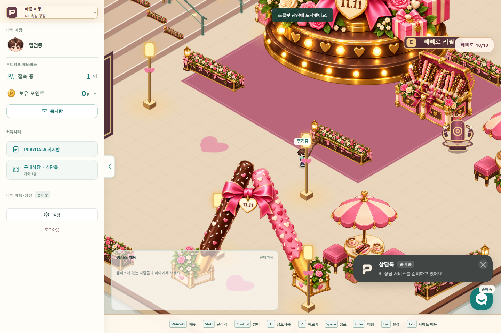

# 빼빼로 이벤트맵 통합 검증 — 2026-10-26

기준: feat/15 `8ea1246`. 원본 로컬 폴더를 변경하지 않은 별도 체크아웃과 Python 3.12 전용 환경에서 검사함.

## 완료한 검사

- backend: Ran 353 tests in 87.135s / OK (skipped=8) / Found 353 test(s). / System check identified no issues (0 silenced).
- frontend: Ran 15 tests in 0.179s / OK / Found 15 test(s). / System check identified no issues (0 silenced).
- launcher: Ran 4 tests in 0.085s / OK (skipped=1)
- loadtools: Ran 2 tests in 0.035s / OK
- Node: ℹ tests 116 / ℹ suites 0 / ℹ pass 116 / ℹ fail 0 / ℹ cancelled 0 / ℹ skipped 0 / ℹ todo 0 / ℹ duration_ms 566.9069
- 정적 파일: Verified 162 collected static files against source
- DB 마이그레이션: 변경 없음 확인함.
- 브라우저: 로그인·이동 WS·달리기·방어·키 변경/복원·옥상 빠른 이동·새 아바타 에셋 8개 로딩 확인함. JS 오류·정적 파일 실패 0건임.
- 이벤트 리필 상자 앞에서 E 입력 후 잔량 10개 지급 확인함. 이벤트 안내창을 닫은 뒤 실제 조작을 검사함.
- 이벤트 원본으로 맵 생성 명령을 실행했고 화면·서버 충돌 생성 파일과 일치함.

## 범위와 제한

- 운영 DB·Redis·Kafka·계정·환경 파일에 연결하지 않음. 테스트 DB와 실제 브라우저용 임시 SQLite 데이터는 Git에서 제외함.
- Backend 환경별 검사 8개는 생략됐음. 실행기 4개 중 POSIX 프로세스 종료 검사 1개는 Windows에서 생략됐음. Ubuntu/WSL에서 별도 실행 필요함.
- 실제 WSL2·Nginx 두 PC 동시 기동·외부 HTTPS/WSS·공유 MySQL/Redis·이벤트 당일 전환·부하 검증은 미실행임.
- 계정당 마지막 위치 하나만 유지함. 모드별 위치 원복은 제공하지 않음.

## 통합 시 보완

- feat/15의 부스 영역·실제 포탈 좌표 회귀 수정과 역할별 실행 파일을 보존함.
- 정적 파일 URL에 고정 날짜 버전을 중복 적용하지 않고 기존 Front의 콘텐츠 해시 갱신을 사용함.
- 같은 시각에 생성된 테스트 Outbox 레코드가 임의 UUID 순서로 바뀌지 않도록 fixture의 created_at 순서를 명시함. 실제 발행 코드는 변경하지 않음.
- 정적 파일 검증기의 Windows 경로 구분자를 정규화하고 POSIX 전용 실행기 검사의 플랫폼 조건을 명시함.

## Draft 유지 — 전체 회귀 미통과

**이벤트 전용·업무 검사 353개는 통과 상태이나, 전체 일반맵 회귀는 완료되지 않음.**

- Ran 611 tests in 112.280s
- FAILED (failures=25, errors=25, skipped=8)
- Found 611 test(s).

일반맵의 고정 좌표·초기 메시지 순서·일반 찌르기 fixture를 그대로 쓰는 검사 등이 남아 있음. 아래 결과를 성공으로 숨기거나 제외해서 전체 통과로 표시하지 않음. 이벤트 브랜치에서 후속 조정 및 재검증 필요함.

전체 회귀 실패·오류 목록

- `ERROR: test_transfer_approval_returns_a_user_bound_ad_token_before_moving (campus.test_authoritative_socket.AuthoritativeSocketTests.test_transfer_approval_returns_a_user_bound_ad_token_before_moving)`
- `ERROR: test_audience_join_and_leave_only_update_affected_sockets (campus.test_continuous_poke.ContinuousPokeTests.test_audience_join_and_leave_only_update_affected_sockets)`
- `ERROR: test_direction_changes_are_throttled_and_keep_the_same_stream (campus.test_continuous_poke.ContinuousPokeTests.test_direction_changes_are_throttled_and_keep_the_same_stream)`
- `ERROR: test_effects_ride_each_recipients_batch_and_a_broken_socket_does_not_stop_the_others (campus.test_continuous_poke.ContinuousPokeTests.test_effects_ride_each_recipients_batch_and_a_broken_socket_does_not_stop_the_others)`
- `ERROR: test_heartbeats_reuse_scope_but_cannot_carry_it_into_a_classroom (campus.test_continuous_poke.ContinuousPokeTests.test_heartbeats_reuse_scope_but_cannot_carry_it_into_a_classroom)`
- `ERROR: test_holding_sends_one_start_and_four_hits_per_second_without_database_reads (campus.test_continuous_poke.ContinuousPokeTests.test_holding_sends_one_start_and_four_hits_per_second_without_database_reads)`
- `ERROR: test_input_lease_stops_a_missing_keyup (campus.test_continuous_poke.ContinuousPokeTests.test_input_lease_stops_a_missing_keyup)`
- `ERROR: test_misses_have_no_repeated_network_packets (campus.test_continuous_poke.ContinuousPokeTests.test_misses_have_no_repeated_network_packets)`
- `ERROR: test_private_npc_hits_only_reach_the_owner (campus.test_continuous_poke.ContinuousPokeTests.test_private_npc_hits_only_reach_the_owner)`
- `ERROR: test_scope_change_stops_the_old_hold (campus.test_continuous_poke.ContinuousPokeTests.test_scope_change_stops_the_old_hold)`
- `ERROR: test_session_checks_remain_in_the_periodic_guard (campus.test_continuous_poke.ContinuousPokeTests.test_session_checks_remain_in_the_periodic_guard)`
- `ERROR: test_ad_transfer_approval_is_stable_and_does_not_move_early (campus.test_motion.ServerMotionTests.test_ad_transfer_approval_is_stable_and_does_not_move_early)`
- `ERROR: test_floor_transfer_must_be_offered_near_a_portal_before_commit (campus.test_motion.ServerMotionTests.test_floor_transfer_must_be_offered_near_a_portal_before_commit)`
- `ERROR: test_control_broadcasts_without_a_position_write (campus.test_poke.PokeControlTests.test_control_broadcasts_without_a_position_write)`
- `ERROR: test_cooldown_rejects_a_second_request (campus.test_poke.PokeControlTests.test_cooldown_rejects_a_second_request)`
- `ERROR: test_last_diagonal_survives_releasing_keys (campus.test_poke.PokeControlTests.test_last_diagonal_survives_releasing_keys)`
- `ERROR: test_other_floor_and_private_occupants_are_excluded (campus.test_poke.PokeControlTests.test_other_floor_and_private_occupants_are_excluded)`
- `ERROR: test_private_classroom_effect_is_only_sent_to_its_owner (campus.test_poke.PokeControlTests.test_private_classroom_effect_is_only_sent_to_its_owner)`
- `ERROR: test_revoked_socket_cannot_overwrite_the_logout_snapshot (campus.test_positions.PositionSocketTests.test_revoked_socket_cannot_overwrite_the_logout_snapshot)`
- `ERROR: test_stale_tab_disconnect_cannot_overwrite_newer_rooftop_position (campus.test_positions.PositionSocketTests.test_stale_tab_disconnect_cannot_overwrite_newer_rooftop_position)`
- `ERROR: test_live_old_socket_is_replaced_and_late_disconnect_keeps_new_player (campus.test_reconnect_transitions.ReconnectSocketTests.test_live_old_socket_is_replaced_and_late_disconnect_keeps_new_player)`
- `ERROR: test_expiry_in_http_saves_latest_position_and_closes_all_session_tabs (campus.test_session_policy.SessionSocketTests.test_expiry_in_http_saves_latest_position_and_closes_all_session_tabs)`
- `ERROR: test_new_browser_closes_all_old_tabs_and_restores_latest_position (campus.test_single_login.SingleLoginSocketTests.test_new_browser_closes_all_old_tabs_and_restores_latest_position)`
- `ERROR: test_oversized_and_malformed_payloads_close_without_ghosts (campus.tests.CampusSocketTests.test_oversized_and_malformed_payloads_close_without_ghosts)`
- `ERROR: test_same_session_tab_replaces_old_presence (campus.tests.CampusSocketTests.test_same_session_tab_replaces_old_presence)`
- `FAIL: test_jump_reaches_the_same_floor_nearby_and_never_private_classrooms (campus.test_jump.JumpControlTests.test_jump_reaches_the_same_floor_nearby_and_never_private_classrooms)`
- `FAIL: test_open_classroom_gate_enters_its_subject_without_door_state (campus.test_motion.ServerMotionTests.test_open_classroom_gate_enters_its_subject_without_door_state)`
- `FAIL: test_socket_frames_do_not_emit_until_final_checkpoint (campus.test_movement_outbox.MovementSocketTests.test_socket_frames_do_not_emit_until_final_checkpoint)`
- `FAIL: test_all_seven_former_classroom_thresholds_are_walkable (campus.test_open_classrooms.OpenClassroomTests.test_all_seven_former_classroom_thresholds_are_walkable) (x=852.75, y=553.5)`
- `FAIL: test_all_seven_former_classroom_thresholds_are_walkable (campus.test_open_classrooms.OpenClassroomTests.test_all_seven_former_classroom_thresholds_are_walkable) (x=1649.25, y=553.5)`
- `FAIL: test_idle_checkpoint_saves_without_closing_the_socket (campus.test_positions.PositionSocketTests.test_idle_checkpoint_saves_without_closing_the_socket)`
- `FAIL: test_last_frame_bypasses_throttle_and_survives_a_fresh_room (campus.test_positions.PositionSocketTests.test_last_frame_bypasses_throttle_and_survives_a_fresh_room)`
- `FAIL: test_rooftop_switch_saves_immediately_and_restores_floor (campus.test_positions.PositionSocketTests.test_rooftop_switch_saves_immediately_and_restores_floor)`
- `FAIL: test_a_server_close_leaves_its_code_and_policy_reason (campus.test_session_policy.SessionSocketTests.test_a_server_close_leaves_its_code_and_policy_reason)`
- `FAIL: test_continuous_movement_cannot_extend_maximum_login_lifetime (campus.test_session_policy.SessionSocketTests.test_continuous_movement_cannot_extend_maximum_login_lifetime)`
- `FAIL: test_server_guard_expires_without_client_logout_or_activity_requests (campus.test_session_policy.SessionSocketTests.test_server_guard_expires_without_client_logout_or_activity_requests)`
- `FAIL: test_socket_pings_do_not_extend_idle_and_expiry_closes_the_socket (campus.test_session_policy.SessionSocketTests.test_socket_pings_do_not_extend_idle_and_expiry_closes_the_socket)`
- `FAIL: test_disconnect_removes_avatar_and_later_connection_has_no_ghost (campus.tests.CampusSocketTests.test_disconnect_removes_avatar_and_later_connection_has_no_ghost)`
- `FAIL: test_door_request_from_an_old_tab_is_ignored (campus.tests.CampusSocketTests.test_door_request_from_an_old_tab_is_ignored)`
- `FAIL: test_expanded_world_positions_and_boundary_validation (campus.tests.CampusSocketTests.test_expanded_world_positions_and_boundary_validation)`
- `FAIL: test_heartbeat_keeps_idle_clients_connected_and_rate_limits_movement (campus.tests.CampusSocketTests.test_heartbeat_keeps_idle_clients_connected_and_rate_limits_movement)`
- `FAIL: test_invalid_positions_and_fields_do_not_broadcast_or_crash (campus.tests.CampusSocketTests.test_invalid_positions_and_fields_do_not_broadcast_or_crash)`
- `FAIL: test_join_snapshot_and_fractional_movement_use_server_identity (campus.tests.CampusSocketTests.test_join_snapshot_and_fractional_movement_use_server_identity)`
- `FAIL: test_logout_in_another_tab_revokes_socket_and_announces_leave (campus.tests.CampusSocketTests.test_logout_in_another_tab_revokes_socket_and_announces_leave)`
- `FAIL: test_nickname_change_is_published_to_existing_connections (campus.tests.CampusSocketTests.test_nickname_change_is_published_to_existing_connections)`
- `FAIL: test_outfit_change_is_shared_with_peers_and_the_open_map (campus.tests.CampusSocketTests.test_outfit_change_is_shared_with_peers_and_the_open_map)`
- `FAIL: test_public_chat_is_rejected_on_the_movement_alias (campus.tests.CampusSocketTests.test_public_chat_is_rejected_on_the_movement_alias)`
- `FAIL: test_rooftop_floor_and_return_to_campus_are_shared (campus.tests.CampusSocketTests.test_rooftop_floor_and_return_to_campus_are_shared)`
- `FAIL: test_stopping_and_room_teleport_are_broadcast (campus.tests.CampusSocketTests.test_stopping_and_room_teleport_are_broadcast)`
- `FAIL: test_unknown_floors_and_rooftop_out_of_bounds_positions_are_rejected (campus.tests.CampusSocketTests.test_unknown_floors_and_rooftop_out_of_bounds_positions_are_rejected)`

이벤트 단위 테스트의 room fixture를 격리했고, 찌르기 소켓 fixture가 현재 이벤트맵의 이동 가능한 위치에서 시작하도록 보완함.

## 확인 화면

