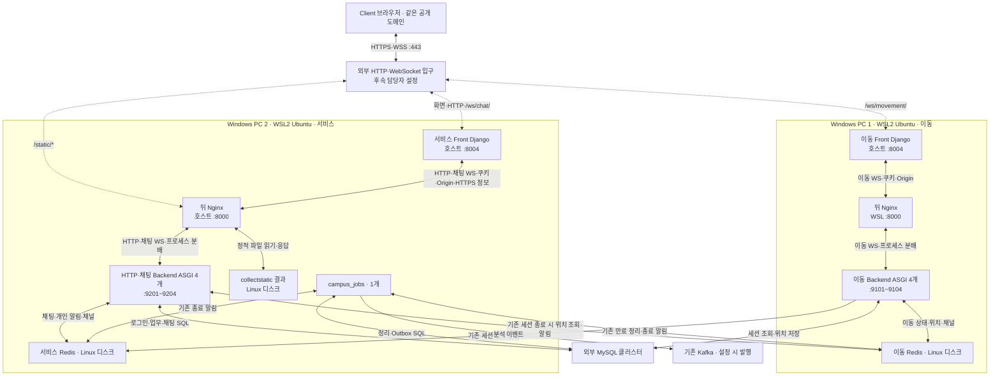

# 온프레미스 역할별 배포

`platform_server/`의 WSL2·Ubuntu 실행 구성이다. 실제 두 PC 배포와 외부 공개 연결은 별도 검증이 필요하다.
Cloudflare 설정은 포함하지 않는다. [외부 연결 명세](deploy/onprem/ingress.md)를 후속 담당자에게 전달한다.

## 1. 전체 다이어그램

- 점선은 후속 연결 범위다. 앞 Nginx 프로세스는 추가하지 않는다.
- 각 Front는 같은 PC의 Backend Nginx로만 전달한다. Nginx는 Front로 되돌리지 않는다.
- Backend는 loopback에서만 수신한다. Front는 같은 PC의 Nginx 주소를 사용한다.
- 다른 PC의 Redis는 사설망 주소로 연결한다.
- 같은 `8004`는 서로 다른 PC의 포트다.

## 2. 데이터 입출력

| 구성요소 | 입력 데이터 | 출력 데이터 |
|---|---|---|
| 이동 Front | 이동 WS·로그인 쿠키·Origin | 이동 Backend 전달·WS 응답 |
| 서비스 Front | 화면·HTTP·채팅 WS | HTML·JSON·채팅 응답 |
| Backend Nginx | Front의 HTTP·WS | 역할별 ASGI 전달·응답 |
| PC 2 정적 저장소 | 같은 코드의 collectstatic 결과 | Nginx가 파일 응답 |
| Backend | 로그인·업무·이동·채팅 요청 | DB 저장·Redis 상태·응답 |
| campus_jobs | 기존 예약 작업·Outbox | DB 정리·Redis 알림·Kafka 발행 |

## 3. 고려한 포인트

- 독립 실행 → `platform_server/`에서 Python 실행기·Nginx 설정·테스트 스크립트 사용.
- 배포 구성 → 기존 실행 파일 보존, 새 배포 폴더·역할 진입점 추가.
- Front 분리 → 이동 HTTP·채팅 WS 차단, 서비스 이동 WS 차단.
- 정적 파일 → campus·accounts·learning 전체 수집, Front와 같은 코드 사용.
- 외부 설정 분리 → [입구 명세](deploy/onprem/ingress.md)만 제공.
- 접속 설정 → 호스트·포트·공개 도메인·외부 MySQL·두 Redis를 환경변수로 지정.
- 기존 동작 → Redis 분리·로그아웃 변경이 병합된 dev를 기준으로 유지.
- 문서 변경 → 변경한 절 번호·제목 기록.

## 4. 아키텍처 주의점

- 현재 제약: 두 Redis 간 교차 접근이 남아 있다. 별도 API로 전환하지 않는다.
- 현재 제약: 두 PC의 Backend와 jobs에서 두 Redis에 접근할 사설 경로가 필요하다.
- 현재 제약: PC·Redis·Front 하나씩이므로 장비 장애를 자동으로 넘기지 못한다.
- 현재 제약: MySQL 마이그레이션과 jobs는 지정한 한 곳에서만 실행한다.
- 현재 제약: 150명 처리 성능과 외부 HTTPS/WSS는 실제 환경에서 측정해야 한다.
- 현재 제약: Windows 재부팅·절전·WSL 종료 시 서비스도 중단된다. 자동 시작과 복구를 확인해야 한다.
- 접근 경계: 기본 게시 주소는 loopback이다. 사설망 게시 시 방화벽 허용 범위를 제한한다.
- 추가 제안: 없음. Redis/API/jobs 재설계는 별도 작업으로 남긴다.

## 5. 기업 사례

이 배포 변경에는 기업 사례를 적용하지 않았다. 기업 운영 방식과 같다고 주장하지 않는다.

## 6. 변경 이력

| 날짜 | 변경 | 변경한 절 |
|---|---|---|
| 2026-10-23 | Cloudflare 설정 없이 WSL2에서 직접 실행할 역할별 배포 구조 작성 | 1. 전체 다이어그램 · 2. 데이터 입출력 · 3. 고려한 포인트 · 4. 아키텍처 주의점 · 5. 기업 사례 · 6. 변경 이력 |
